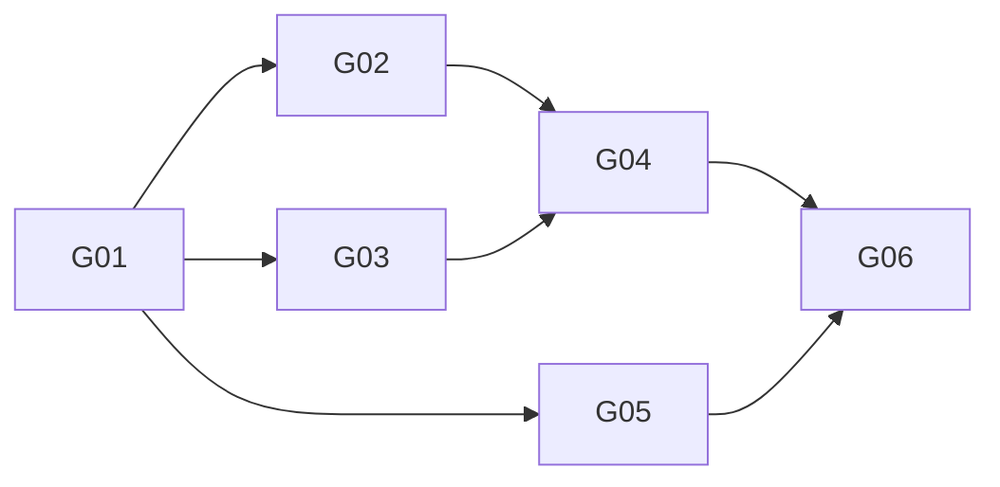

# Garden × Hermes Story计划索引

授权、状态与依赖的机器源：[../status.json](../status.json)。本表按该源生成/校验；正文合同只在 [../CONTRACTS.md](../CONTRACTS.md) 与 [../ARCHITECTURE-SPINE.md](../ARCHITECTURE-SPINE.md) 维护。

基线：Hermes `bf0203a794a07aac3ff764972ab9087baa4e4f4e`；Laputa `425a15b02d4975954362a91515f95709f46d3bfb`。所有产品Story `implementation_authorized=false`，没有任何Ready/implemented/tested/done声明。

| Story | Epic / 需求 | 成果 | 直接前置及消费输出 | 计划 | 状态 |
| --- | --- | --- | --- | --- | --- |
| G01 | E1基础 / R01,R04,R07,R08 | 薄插件绑定、严格类型与私有记录底座 | 无；先获开工授权 | [G01](G01.md) | planned |
| G02 | E1候选 / R02,R03,R07,R08 | 显式证据分类、候选与no-op，无人格写入 | G01：绑定、类型、store | [G02](G02.md) | planned |
| G03 | E1采纳 / R04 | 独立审阅/许可、默认拒绝的策略 | G01：可信上下文与Candidate合同 | [G03](G03.md) | blocked：D01 |
| G04 | E2应用 / R01,R05,R06 | 原生SOUL应用、未知状态对账、有条件回滚 | G02：候选；G03：可信许可 | [G04](G04.md) | blocked：D02及写入边界 |
| G05 | E2生效 / R06,R07 | 能力检测与新验收会话激活探针 | G01：绑定、ActivationReceipt合同 | [G05](G05.md) | planned |
| G06 | E2闭环 / R01-R08 | 接线、隔离集成与获准真实松柏闭环 | G04：持久化/恢复结果；G05：激活证据 | [G06](G06.md) | blocked：实施/真实数据授权 |

## 拓扑波次（逻辑，不代表当前可执行）

- W0：G01。
- W1：G02、G03、G05。
- W2：G04。
- W3：G06。

D01、D02和开工/真实数据许可是外部门槛，不伪装成已经完成的Story依赖。拓扑属于同一波不代表Ready。

## 文件冲突与派工

G01先冻结domain/host/store合同；W1各自只拥有proposal.py、review.py、activation.py及对应测试，不并行编辑__init__.py、共享类型或配置。G06统一接线与package/操作技能文档。需要改合同由松柏先改合同并使下游计划失效，不让工作者偷偷另选架构。

## 交付准则

每个Story提供精确差异、验证命令真实输出、失败/未覆盖项与授权边界。所有验证命令均是开工后的计划，不是本轮已执行记录。只读源码核对证据见 [../HERMES-SOURCE-AUDIT.md](../HERMES-SOURCE-AUDIT.md)。
