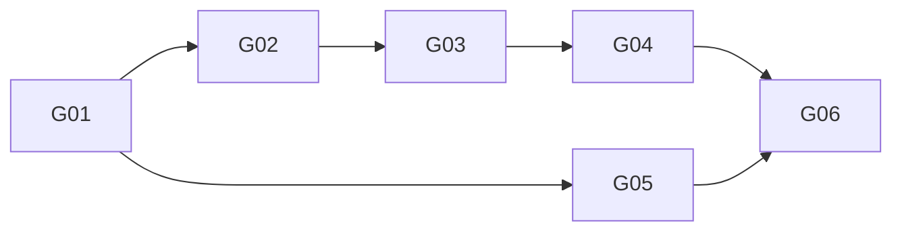

# Garden × Hermes 唯一 Story 计划（纯文本多文件 v4）

修订 `2026-10-31-plain-multifile-persona-v4`；状态/依赖源：[status](../status.json)。所有 Story `implementation_authorized=false`，无 Ready/Done。v2 的独立 worker、JSON 台账/持久队列及等待 D01–D03 的旧计划已退出。

共享 [架构](../ARCHITECTURE-SPINE.md)、[合同](../CONTRACTS.md)、[受管阶段接缝](../HERMES-REVIEW-BRIDGE.md)。Hermes 静态基线 `bf0203a794a07aac3ff764972ab9087baa4e4f4e`；新文件/接口均拟议，不能按现成能力使用。

| Story | 需求 | 成果 | 直接前置及消费输出 | 计划 | 状态 |
| --- | --- | --- | --- | --- | --- |
| G01 | R01,R04,R08,R10 | 共享人格目录/文件绑定、全文件使命保护、最小恢复材料基础 | 无；仍需开工授权 | [G01](G01.md) | planned |
| G02 | R02,R07,R09 | 同原生任务 persona stage、可信投影与父任务取消 | G01：范围/快照/取消与 Markdown fixture 合同 | [G02](G02.md) | planned |
| G03 | R02,R03,R04,R07 | 有界人格 patch/no_change/使命变更拒绝与授权提示 | G02：受管 stage/获准证据/取消 guard | [G03](G03.md) | planned |
| G04 | R01,R04,R05,R06,R08,R10 | 确定性组装、短提交、回读与部分失败检查 | G03：通过文件级权限/使命检查的 FileReplacement 和完整输入版本 | [G04](G04.md) | planned |
| G05 | R01,R06,R07 | 指定新会话实际身份块验证 | G01：绑定/合成 SOUL fixture/ActivationReceipt | [G05](G05.md) | planned |
| G06 | R01–R10 | 自动接线、真实共享源→SOUL→新会话闭环 | G04：组装/应用结果；G05：有效性证明 | [G06](G06.md) | blocked：真实绑定/数据与实施授权 |

## 依赖波次

W0：G01。W1：G02、G05。W2：G03。W3：G04。W4：G06。逻辑可并行不表示已获开工许可。

## 文件所有权

G01 独占 domain/host/markdown/初始 package；G02 独占获准隔离 Hermes 接缝与 stage adapter，G05 独占 activation；G03 独占 proposal/review；G04 独占 assemble/apply；G06 统一注册/manifest/操作技能和集成测试。共享合同修正由 supervisor 先处理，下游重新校验，不让实现者改回 v2 状态引擎。

D01–D04 是已决定设计，不再作为用户待选问题；源绝对路径/初始 Mission/已有 SOUL 接管、代码/core 修改、资料/费用、配置/安装/启用/写入和验收 session 是未来实施授权，不由计划自动产生。所有测试命令均是未来计划。