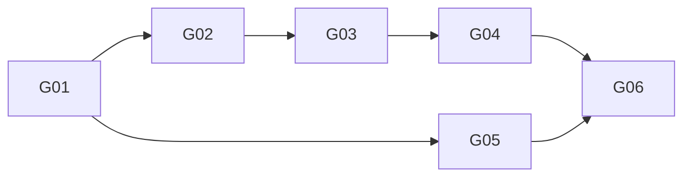

# Garden × Hermes 唯一 Story 执行计划

修订 `2026-10-31-native-review-v2`；状态/授权/依赖唯一机器源：[../status.json](../status.json)。本轮重写 G01–G06 的职责和依赖，旧“手动候选主路径”不再有效。所有 Story `implementation_authorized=false`，无 Ready/Done。

架构：[详细架构](../ARCHITECTURE-SPINE.md)；共享字段：[CONTRACTS](../CONTRACTS.md)；宿主合同：[bridge](../HERMES-REVIEW-BRIDGE.md)。源码基线 Hermes `bf0203a794a07aac3ff764972ab9087baa4e4f4e`；Laputa 整理基线 `425a15b02d4975954362a91515f95709f46d3bfb`。

| Story | Epic / 需求 | 可观察成果 | 直接前置与消费输出 | 计划 | 状态 |
| --- | --- | --- | --- | --- | --- |
| G01 | E1 底座 / R01,R04,R07,R08 | 可信范围、严格类型、私有状态/锁和无隐式副作用底座 | 无；开工授权仍缺 | [G01](G01.md) | planned |
| G02 | E1 原生接缝 / R02,R07,R08,R09 | 隔离宿主 start/end + 证据投影 + 惰性工作器/撤权 | G01：绑定、RunRecord、store/锁合同 | [G02](G02.md) | blocked：D03 |
| G03 | E1 人格候选 / R02,R03,R04,R07,R08 | 有界归纳、反例/分流、no-op、严格采纳策略 | G02：可信 ready run、投影、生命周期/取消合同 | [G03](G03.md) | planned；D01 未定则仅 candidate_only |
| G04 | E2 应用恢复 / R01,R04,R05,R06 | SOUL 应用/对账/有条件回滚 | G03：精确候选/基线与可信决策 | [G04](G04.md) | blocked：D01/D02 |
| G05 | E2 生效 / R01,R06,R07 | 新验收会话的实际身份块证明 | G01：home 绑定、ActivationReceipt 与隔离 fixture | [G05](G05.md) | planned |
| G06 | E2 集成 / R01–R09 | 自动接线、负例/故障矩阵与获准真实闭环 | G04：应用/恢复结果；G05：有效性证明 | [G06](G06.md) | blocked：实施/决策/真实试验授权 |

## 拓扑波次（逻辑，不代表允许开工）

- W0：G01。
- W1：G02、G05。
- W2：G03。
- W3：G04。
- W4：G06。

依赖只记录直接前置；继承的共享基础不加冗余传递边。D01/D02/D03 和开工/数据许可是外部门槛，不伪装为 Story 成果。关键阻塞在原生 bridge、写者合同与真实生效，不虚构工期。

## 文件所有权与派工

G01 独占 domain/host/store/初始 package；合同先冻结。W1 的 G02 独占 lifecycle 与获准的隔离 Hermes bridge，G05 仅 activation；两者不并行改共享模块/注册入口。G03 独占 proposal/review，G04 独占 apply。G06 最终统一 __init__/plugin manifest/skill/操作文档和集成测试；共享合同修改由松柏先处理并重校所有下游。

当前只做文档，不派实现者。未来 handoff 必须包含本修订、计划、共享合同、已验收前置、精确允许文件、停止条件及授权范围；每项真实命令输出需回交 supervisor。规划中的测试命令不是已运行结果。
