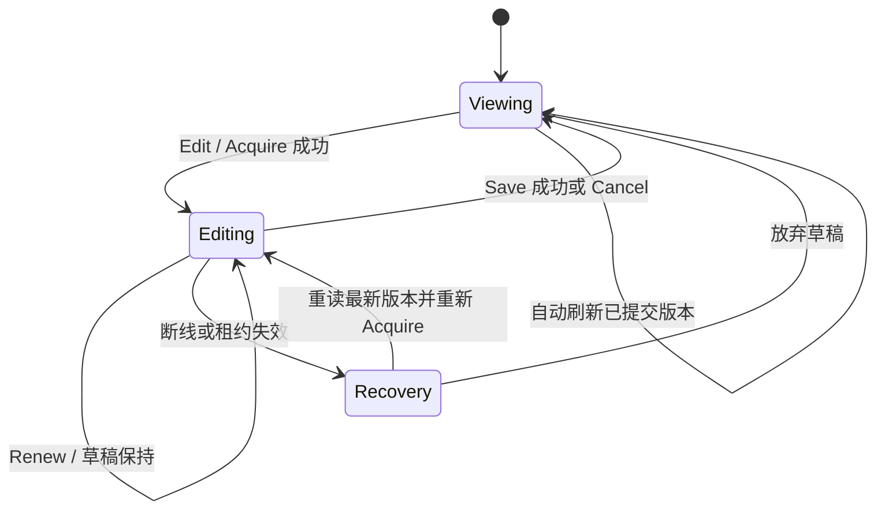

# Garden 受控编辑与自动宿主人格更新：只读研究报告

**日期：** 2026-10-12
**状态：** 供调研会讨论；所有推荐均未获实现批准。
**仓库与分支：** `ProjectViVy/laputa` / `feat/garden-standalone-v1`
**固定基线：** `3c4cfffe33d92ad1105ad31dec259c901cc24a4e`。本次核对的 checkout HEAD 和远端分支头均为此提交。
**方法：** 使用 Superpowers `using-superpowers`、`brainstorming` 的上下文核查、方案比较和自审方法；仅阅读代码、计划及宿主官方源码/文档。没有实现代码、运行产品测试、安装宿主、修改宿主配置、提交、推送或创建 PR。本报告独立保存在任务工作区，不改变现有规格或计划状态。

> **后续规划说明：** 用户随后授权增强 Garden、形成规格/计划并发布文档。本报告保留调研阶段的讨论语义；当前选定方案与执行状态以[规格 §7](../superpowers/specs/2026-10-12-garden-standalone-v1-design.md#7-controlled-editing-and-automatic-host-projection)、[计划索引](../superpowers/plans/garden-standalone-v1/index.md)及[固定宿主证据](garden-host-pins-2026-10-12.md)为准。早期“未找到 Hermes/Codex 原生 hook”的结论已经固定源码更正。

## 1. 结论与建议

建议把讨论方向落在一个很小的组合上：**本地对象短租约 + 已有 revision 校验 + 宿主原生动态上下文接口**。

1. 默认浏览界面自动刷新已提交内容；点击 Edit 成功取得编辑权后，固定编辑起点和草稿，暂停这份草稿的自动刷新。所有受控 Persona 写入都在同一权威服务边界检查编辑权与版本。
2. 同对象正在编辑时，Laputa 提交返回明确冲突；宿主自动投影合并成一个可重算的 pending 提示。保存、取消或租约到期不会偷偷重放旧写入。用户手动 Retry 从最新权威版本和当前宿主状态重新计算。
3. 自动宿主更新优先通过原生 hook 在下一次受支持的 prompt/turn 边界读取当前已提交 Persona，不反复改写共享 `SOUL.md`、`AGENTS.md` 等文件。**这仍是实际自动更新，需要完成真实宿主接入；只有编辑锁和手工复制不算交付。**
4. 对共享外部文件保留 S08 的不覆盖策略。Garden 专属派生文件可以是较便宜的后备路线，但只能在明确单写者约定下自动替换，不能保证独立 VS Code 并发保存不丢失。
5. 手工编辑的权威数据与宿主派生内容必须分层：保存 Persona 不等于宿主已加载；宿主加载不产生新的 Persona revision；Revoke 不等于擦除宿主文件或历史上下文。

重要新发现：在本次检查的固定源码中，**Hermes 和 Codex 均存在原生上下文 hook**。不能继续以“没有 hook”为前提推荐迁移 Hermes profile 或缩小 Codex workspace。原生路径仍需要后续隔离宿主运行验收，源码存在接口不代表本分支已经集成。

## 2. 固定基线：已经有什么，缺什么

以下链接全部固定到上述 Laputa SHA，不引用工作区未提交规格作为已批准事实。

| 事实 | 源代码/计划证据 | 对本研究的影响 |
| --- | --- | --- |
| Persona 页仅有 React `editing`、`draft`；保存使用当时的 `data.revision`。 | [PersonaPage.tsx 74–109](https://github.com/ProjectViVy/laputa/blob/3c4cfffe33d92ad1105ad31dec259c901cc24a4e/garden/console/src/modules/persona/PersonaPage.tsx#L74-L109) | 尚无服务端编辑权；直接加轮询还可能把旧草稿配上新 revision，必须固定编辑起点。 |
| 通用数据 hook 支持轮询，但 Persona 详情未传 poll。 | [api/hooks.ts](https://github.com/ProjectViVy/laputa/blob/3c4cfffe33d92ad1105ad31dec259c901cc24a4e/garden/console/src/api/hooks.ts)、[PersonaPage.tsx](https://github.com/ProjectViVy/laputa/blob/3c4cfffe33d92ad1105ad31dec259c901cc24a4e/garden/console/src/modules/persona/PersonaPage.tsx#L81) | 可复用读取机制，需防乱序响应、编辑期间刷新草稿和切换 Profile 的迟到请求。 |
| PUT 已要求 base_revision，按调用者与 scope 路由到保存方法。 | [persona_api.go 188–252](https://github.com/ProjectViVy/laputa/blob/3c4cfffe33d92ad1105ad31dec259c901cc24a4e/garden/internal/server/persona_api.go#L188-L252) | 保留权限和 revision 语义；不能靠 UI 自报 editing=true 实现互斥。 |
| Persona service 用 mutex 串行化服务内写入，核心校验 baseRevision。 | [service.go 530–619](https://github.com/ProjectViVy/laputa/blob/3c4cfffe33d92ad1105ad31dec259c901cc24a4e/laputa/persona/service.go#L530-L619)、[837–939](https://github.com/ProjectViVy/laputa/blob/3c4cfffe33d92ad1105ad31dec259c901cc24a4e/laputa/persona/service.go#L837-L939) | 这是最小编辑权落点；HTTP 一层加锁不能覆盖其他内嵌调用。 |
| 无 base 参数的 SaveAgentP16 在提交时读取 current.Revision；带 Revision 版本由调用者提供基线。 | [service.go 573–619](https://github.com/ProjectViVy/laputa/blob/3c4cfffe33d92ad1105ad31dec259c901cc24a4e/laputa/persona/service.go#L573-L619) | 旧生成正文可能被重新标成最新版本提交。需要迁移/限制无基线入口；本仓库非测试 Go 调用搜索未发现 `.SaveAgentP16(`，外部消费者仍需盘点。 |
| 审批检查 BaseRevision 和 BaseHash；普通写入会把旧 pending proposal 标 stale。 | [AcceptRequest 711–759](https://github.com/ProjectViVy/laputa/blob/3c4cfffe33d92ad1105ad31dec259c901cc24a4e/laputa/persona/service.go#L711-L759)、[stalePendingLocked 942](https://github.com/ProjectViVy/laputa/blob/3c4cfffe33d92ad1105ad31dec259c901cc24a4e/laputa/persona/service.go#L942) | 复用既有提案机制，不建设第二套自动重放队列。 |
| 读取的正文来自当前 Markdown 文件，revision 来自历史；外部修改可能改变 hash 而 revision 不变。 | [readDocumentUncheckedLocked 189–227](https://github.com/ProjectViVy/laputa/blob/3c4cfffe33d92ad1105ad31dec259c901cc24a4e/laputa/persona/service.go#L189-L227) | 编辑保存宜同时检查起点 hash；检测到外部漂移应停下。hash 检查仍不能消除之后的文件竞争。 |
| 初始化和 Repair 有独立、多文档操作；Repair 会逐项写并支持回滚。 | [Initialize 378](https://github.com/ProjectViVy/laputa/blob/3c4cfffe33d92ad1105ad31dec259c901cc24a4e/laputa/persona/service.go#L378)、[Repair 475–525](https://github.com/ProjectViVy/laputa/blob/3c4cfffe33d92ad1105ad31dec259c901cc24a4e/laputa/persona/service.go#L475-L525) | 必须在任何副作用前检查整个受影响对象集合，不能写一半后才发现另一对象有编辑锁。 |
| FilePlan 是包含完整 proposed content、原文件 hash、来源 revision 的预览快照。 | [projection.go 10–23、62–108](https://github.com/ProjectViVy/laputa/blob/3c4cfffe33d92ad1105ad31dec259c901cc24a4e/garden/internal/hosts/projection.go#L10-L108) | 重试应重算，不执行旧 FilePlan；多 kind 读取也宜改成一致快照。 |
| Apply 对已存在目标明确 conflict；不存在才用 os.Link no-clobber 创建。 | [status.go 87–196](https://github.com/ProjectViVy/laputa/blob/3c4cfffe33d92ad1105ad31dec259c901cc24a4e/garden/internal/hosts/status.go#L87-L196)、[files.go 85–112](https://github.com/ProjectViVy/laputa/blob/3c4cfffe33d92ad1105ad31dec259c901cc24a4e/garden/internal/hosts/files.go#L85-L112) | 首次创建可用，现存文件自动更新尚未完成。 |
| Revoke 先撤销 binding，再保留文件并提示清理；后续重试只观察清理。 | [status.go 291–343](https://github.com/ProjectViVy/laputa/blob/3c4cfffe33d92ad1105ad31dec259c901cc24a4e/garden/internal/hosts/status.go#L291-L343) | 保持撤权与文件清理分开，不能恢复旧 compare/backup/replace。 |
| Binding 有容量 32 KiB 的 Projection JSON。 | [bindings.go 209–230](https://github.com/ProjectViVy/laputa/blob/3c4cfffe33d92ad1105ad31dec259c901cc24a4e/garden/internal/registry/bindings.go#L209-L230) | 足以复用作小量 pending/revision/状态元数据，无需新数据库。 |
| 索引记录 S01/S02/S03 基础、S08 保守实现；S08 自动化验收 pending，S09/S10 仍 blocked。 | [index.md readiness](https://github.com/ProjectViVy/laputa/blob/3c4cfffe33d92ad1105ad31dec259c901cc24a4e/docs/superpowers/plans/garden-standalone-v1/index.md#L90-L104)、[R4 记录](https://github.com/ProjectViVy/laputa/blob/3c4cfffe33d92ad1105ad31dec259c901cc24a4e/docs/superpowers/plans/garden-standalone-v1/index.md#L225-L243) | 历史检查通过的是缩减后的安全合同，不能证明原自动更新交付。宿主新证据可解除部分“接口未知”，不能直接把 Story 改成完成。 |

### 两层权威与生效边界

| 层 | 事实来源 | 允许修改 | 不能推导的结论 |
| --- | --- | --- | --- |
| Laputa Persona | 规范 Markdown、revision 历史、既有审批 | 人工保存、已有权限允许的明确写入 | 编辑租约不会新增自动演化权限。 |
| Garden → 宿主投影 | 特定 binding 的 source revisions、派生文本及宿主运行状态 | 原生 hook 返回上下文，或明确托管的派生文件 | 投影不能反向提交 Persona，也不能凭 API 返回成功声称模型已加载。 |

既有 Garden/VIVY Frozen Core 在已接纳 session 内不可变。外部宿主动态贡献必须作为另一个明确接口讨论，不能暗中改变 Frozen Core 捕获语义。WORLD 仍 tool-only；ACTMEM 不作为 Persona 混入同步；Mission/Dream 等治理规则不能因自动同步放宽。见 [ADR-0018](https://github.com/ProjectViVy/laputa/blob/3c4cfffe33d92ad1105ad31dec259c901cc24a4e/docs/architecture/0018-vivy-unified-context-and-recap-policy.md)。

## 3. 三条整体路线的取舍

| 路线 | 自动更新如何实现 | 人工修改保护 | 代价与适用性 |
| --- | --- | --- | --- |
| **A：短租约 + 原生动态 hook（推荐）** | 原生 prompt/turn 边界从 Garden 拉最新已提交版本；平时无需点 Apply。遇编辑权则 pending，手动重试后恢复自动路径。 | 不写共享指令文件，因此不会通过文件替换覆盖 VS Code 保存；权威服务内由租约和 revision 拒绝旧提交。 | 每宿主薄适配器；必须资格验证事件频率、优先级、启用权限。不能承诺清空历史或立即改变已开始请求。 |
| **B：短租约 + Garden 独占派生文件/include** | 用户一次性接入命名明确的专属输入；Garden 后续生成并原子替换自己的文件，宿主按其加载周期读取。 | 减少共享面；检测到不符合上次生成 hash 的内容就冲突。前提是约定该文件只有 Garden 写。 | 有 include/追加文件加载能力才成立。若用户仍直接编辑同一路径，最后一次 hash 检查后的竞争无法排除。只在接受这项边界时采用。 |
| **C：继续共享文件手工应用** | 沿用 S08：首次 no-clobber 创建，已有目标用户手工改。 | Garden 不主动替换已有文件，保留人工当前字节。 | 最省开发，但不满足原自动动态更新目标。可以保留为不支持宿主的明确降级，不能拿它宣布整体完成。 |

不建议为了“统一”先造跨宿主文件写入框架。路线 A 已出现可用源码接口，先验证它。路线 B 不是不可能，也不需要安全平台：一个明确的单写者文件所有权约定就足够描述其支持范围；但不能把它包装成并发编辑保护。

## 4. 编辑权：为什么短租约是必要的小复杂度

| 机制 | 能做到 | 不能做到 |
| --- | --- | --- |
| 前端 editing 布尔值 | 切换按钮/文本框 | 后端不知道；另一个 tab、agent API 不受约束。 |
| 服务端永久 editing 标记 | 受控 writer 可检查 | 断网或关页留下永久占用；无 token 时旧窗口可能释放新窗口状态。 |
| 仅 base_revision | 拒绝旧版本提交 | 无法提前告知 Laputa 有人正在编辑，也不表达用户要求的暂停/手动重试体验。 |
| **短租约 + owner token + 代次 + revision** | 一个对象一个有效编辑者；失联自动回收；旧页操作可被拒绝 | 对不经过服务的外部文件写入没有排他性。 |

建议只在已有单 owner、单进程 Persona service 中维护内存租约表，键为 **ProfileID + Persona kind**。USER 各 section 共享一把文档锁，先不引入 section 并行。token 随机、每次 Acquire 更新代次；进程重启使旧 token 无效，代次只服务于拒绝旧请求，不建设分布式 fencing 平台。

可直接给出工程起点：TTL 120 秒、每 30 秒续租；只读页面前台约每 2 秒刷新并在聚焦时立即读一次。参数后续按实际体验调整，不需要让用户逐个选择。页面休眠/断线会使租约自然过期；服务端时间决定有效性，浏览器倒计时只是提示。

### 最小操作语义

- **Acquire**：携带当前 revision、content hash 和本 tab 请求 ID；服务在同一 mutex 下校验起点、到期旧锁并建立新锁。请求 ID 使丢失响应后的重复 Acquire 不误判为另一窗口。未成功前不进入可保存编辑态。
- **Renew**：必须匹配对象、token、代次且尚未过期；不能把已过期锁复活。失联后保留当前 tab 内草稿，但停止 Save。
- **Save**：携带固定的编辑起点 revision/hash 与 token/代次；同一临界区核验编辑权、基线、权限和内容，再提交及释放。校验失败保留草稿与适用的有效租约，不自动覆盖最新内容。
- **Cancel/Release**：只释放当前 token 对应的锁；重复释放可幂等。旧窗口的迟到释放不能清理后来窗口的锁。离开页面尽力释放，正确性依靠到期回收而不是 unload 一定送达。
- **过期恢复**：重新读最新内容、重新 Acquire，展示草稿与新版本差异。不能给旧 body 偷换最新 revision 后直接保存。
- **Save 响应丢失**：先重新读取权威 revision/history/hash 判断服务器是否已保存；相同结果显示已保存，存在不同的新内容则展示冲突。不能把一次超时等同于提交失败后盲目重发。
- **Profile 切换**：编辑对象的 ProfileID 固定到操作生命周期；先提示未保存草稿、释放原 Profile 锁。旧 heartbeat/release 不能使用全局当前 Profile。现有 [client.ts](https://github.com/ProjectViVy/laputa/blob/3c4cfffe33d92ad1105ad31dec259c901cc24a4e/garden/console/src/api/client.ts) 每次调用读取 activeProfile，需专门处理这一点。

草稿第一版保存在当前 tab 内存即可。断线期间保留；**关闭页面或浏览器崩溃后不承诺草稿恢复**。租约恢复和草稿持久化是两件事；如后续需要崩溃恢复，应单独决定本机草稿保存位置/生命周期，不顺手把私人人格放进永久 localStorage。

## 5. 所有受控写入必须经过同一入口

仅在 HTTP PUT 检查锁不足够。需要覆盖 `SaveUserDocument`、`SaveUserObservations`、`SaveAgentP16WithRevision`、批准提案、历史重新保存、HumanClient 内嵌调用，以及 Initialize/Repair 的文档提交。权限允许并不意味着可以跨过编辑锁。

`SaveAgentP16(kind, content, reason)` 在提交时自行取最新 revision，不足以证明 content 基于最新版本生成。推荐迁移所有真实消费者到要求明确基线的方法，再去除或限制无基线写入；本次只记录风险，不改 API。

普通自动写入被锁后：返回 `edit_locked`，保留已有提案/原请求意图；如果原流程是直接生成写入、没有可持久化提案，提示用户在该流程重试即可，**不要为它新增通用后台重放服务**。重试生成必须读取最新版本；人工保存后已有旧提案按现有语义 stale。

检查锁、取多 kind 投影快照、确定本次准入应该在同一个短临界区内。外部网络、模型调用和插件执行必须在锁外。某次投影若在 Edit 取得锁之前已准入，允许它完成；UI 不承诺撤回已开始的宿主请求。否则必须引入跨宿主事务，而这不是本地轻量协议需要承担的范围。

## 6. 自动更新、待办合并与手动重试

### 正常自动路径

宿主插件已由用户启用、binding 已授权 PersonaSync 后，每个受支持的下一轮 prompt 自动请求 Garden；Garden 读当前已提交权威快照，返回一个有来源 revision/hash 的有限长度贡献。不需要用户每轮复制、点同步，也不需要另建定时调度器。未发生新 prompt 的空闲宿主显示“等待下一轮”，不能声称已经加载。

原生适配器应固定到安装时批准的 Profile、宿主实例与作用域，继续复用现有认证和 binding controls。请求不允许通过临时 ProfileID/path 选择另一份权威数据。传版本与会话标识用于状态核对即可，不需要上传会话正文或建设新权限平台。

### 发生编辑阻塞

权威写入和宿主投影分别处理：

| 被阻塞对象 | 保留什么 | 释放编辑权后 |
| --- | --- | --- |
| Persona 写入候选 | 原 proposal/意图及 base revision；不用全量旧 body 构建第二队列 | 用户重新执行原写入/评审流程；若基线变化重新生成/审查。 |
| 宿主投影 | 每 binding 一个 pending 标记、原因、相关 kind/最新目标 revision 清单、首次/最近阻塞时间 | 保持“需手动重试”，不因 Save/Cancel/TTL 自动重放。 |

同一 binding 多次触发只更新这个小记录；不能刷出几十条相同待办。每个宿主可有多个 kind，选择其中任一个被锁时暂停该次整份组合投影，避免混合不同来源快照。

### Retry 的建议合同

1. 点击“重新预览并重试”时重新读最新 Persona revision/hash、当前编辑权、binding controls、adapter/宿主版本与作用域；文件路线还读当前磁盘内容。丢弃旧 FilePlan。
2. 展示将送出的最新版本/差异；确认时再次比较预览基线。有新人工保存、新编辑周期、撤权或作用域变化，则要求重新预览。编辑周期也需纳入失效判断：Acquire 后 Cancel 可能不改 revision，但旧确认不应跨过一次新编辑周期。
3. 原生拉取路线可以保存一个短期“准许下一次重试”的预览基线；宿主离线时显示“等待宿主”。下一次实际请求再次核对版本、作用域和基线并重新渲染，不能把服务器缓存的旧正文发送出去。
4. 若确认到真正拉取之间权威又变化，保留 pending 并提示预览过期；不要悄悄确认另一份内容。成功返回新贡献后恢复正常自动路径，后续已授权、未受锁的新 revision 可自动进入下一轮。
5. 租约和短期预览可在内存中；pending 复用现有持久元数据，重启不丢。重启使预览失效，要求重新预览即可，无需可靠任务执行平台。

这是为了满足“手动重试不得覆盖刚保存的人工修改”，而不是让人工逐次批准正常自动同步。原生路线不回写 Persona，也不替换宿主共享文件；文件路线无原生 CAS 时仍不能自动覆盖共享现存目标。

### UI 状态流

投影状态与编辑状态是两条轴，避免把“文档已保存”误当“宿主已更新”：

`自动等待下一轮 → 发现编辑锁 → 需要手动重试 → 新预览 → 等待宿主 → 已提供最新贡献 → 自动等待下一轮`。

推荐可见文案：

- 编辑中：“你正在编辑。此文档的自动写入已暂停。”
- 发生阻塞：“编辑期间有更新未执行。保存或取消后，请重新预览并重试。”
- 失联：“编辑权已失效；草稿仍在本页。重新连接并比较最新版本后继续。”
- 宿主原生拉取：“已提供 rev N，实际加载状态未知”或“等待下一轮”；不能显示“文件写入成功”。

状态保持四层：**saved** 是权威已提交；**written** 只描述真实文件/配置持久写入，原生 hook 路线不适用；**offered** 可描述已返回给 hook；**loaded** 只有对应宿主/session/revision 的真实观察证据才能成立。HTTP 200、模型回答“知道了”都不足以证明精确 prompt 已加载。

## 7. 四类宿主：固定版本能力和真实限制

这些是候选资格验证版本，不是自动扩大到所有新旧版本的兼容范围。OpenClaw、Hermes、Codex 的本地源码 checkout SHA 已逐一读取核对；没有安装/运行真实宿主。Claude Code 只有公开发布和文档证据，闭源运行时尚待验证。

### 7.1 OpenClaw

**固定版本：** `v2026.10.2`，commit `b8952d477f0c932d8ddc6da5c89cab5a169b6ff1`。

- `before_prompt_build` 的结果类型支持 `appendSystemContext` / `prependSystemContext`；embedded runner 实际将其与原 system prompt 组合。推荐新增 Garden 贡献，避免返回用于整段替换的 `systemPrompt`。[类型](https://github.com/openclaw/openclaw/blob/b8952d477f0c932d8ddc6da5c89cab5a169b6ff1/src/plugins/hook-before-agent-start.types.ts#L20-L48)、[实际组装](https://github.com/openclaw/openclaw/blob/b8952d477f0c932d8ddc6da5c89cab5a169b6ff1/src/agents/embedded-agent-runner/run/attempt-prompt-build.ts#L280-L315)。
- 非内置插件需要显式 `allowConversationAccess: true`，且不能禁用 prompt injection；不能静默改宿主配置取得许可。[固定权限文档](https://github.com/openclaw/openclaw/blob/b8952d477f0c932d8ddc6da5c89cab5a169b6ff1/docs/plugins/hooks.md#L118-L145)。
- `agents.files.set` 即使携带 expectedHash，也只是 Gateway 队列内检查后写入；源码说明 shell writer 独立。它**不是**对 VS Code 的原子 CAS。[实现 380–489](https://github.com/openclaw/openclaw/blob/b8952d477f0c932d8ddc6da5c89cab5a169b6ff1/src/gateway/server-methods/agents-files.ts#L380-L489)。
- `config.get/config.patch` 的 baseHash 用于 JSON 配置；JSON include 可以拆配置对象，但不能据此称 SOUL Markdown 有同样 include/CAS。[Config RPC](https://docs.openclaw.ai/gateway/configuration/config-rpc)、[配置 include](https://docs.openclaw.ai/gateway/config-secrets-env)。

**建议：** 先资格验证固定版本 embedded runner 的动态 hook，在现有 workspace 上工作；不要承诺所有 harness 都相同。真实权限拒绝、下一轮更新、原 prompt 保留和撤权行为仍需后续验证。

### 7.2 Hermes

**固定版本：** `v0.21.7`，commit `71d34bad1045610252eda02ee79549436896e784`。

- 原生 `ctx.register_hook("pre_llm_call", callback)` 可返回 `{"context": markdown}`。实际调用每个 persistent turn 收集贡献，注入 user message 上下文，**不是 system/SOUL 优先级**；`_persist_disabled` 路径跳过。[插件注册](https://github.com/NousResearch/hermes-agent/blob/71d34bad1045610252eda02ee79549436896e784/hermes_cli/plugins.py#L934-L975)、[真实收集逻辑](https://github.com/NousResearch/hermes-agent/blob/71d34bad1045610252eda02ee79549436896e784/agent/turn_context.py#L793-L848)。
- 另有 `register_system_prompt_section`，但其接口注明 session prompt 冻结；不能将它当作每轮热更新。动态 user-context 与冻结 system section 不宜同时注入两份 Garden 版本。[同一注册实现](https://github.com/NousResearch/hermes-agent/blob/71d34bad1045610252eda02ee79549436896e784/hermes_cli/plugins.py#L957-L980)。
- 虽然注入注释使用 ephemeral，一次实际送出的 `api_content` 会在历史行重放。因此不能承诺过去的注入文本被清空，后续新贡献也不是历史重写。[请求组装/重放](https://github.com/NousResearch/hermes-agent/blob/71d34bad1045610252eda02ee79549436896e784/agent/turn_context.py#L1250-L1305)。
- 新 profile 会分离配置、SOUL、memory、sessions 等，这不是无感接入。发现同 profile hook 后，无需把 profile 迁移作为默认方案。[官方 profiles](https://hermes-agent.nousresearch.com/docs/user-guide/profiles)。

**建议：** 优先原 profile 的 persistent turn hook，保持现有 SOUL 与历史。需用户接受“动态补充上下文”是否满足人格管理目标；如果必须替换最高优先级 SOUL，当前这一 seam 不满足那个更强目标，需继续研究冻结边界。MemoryProvider 是记忆召回/捕获接口，不等于人格接口。worker/ephemeral 不自动继承 Persona。

### 7.3 Codex CLI

**固定版本：** `rust-v0.162.1`，commit `092d3acd6bec3e3a14bdc7e7a2810ab628ab759d`。

`UserPromptSubmit` 实现收集 additional context，且存在原生 hook 配置发现和插件来源；不是只能通过 AGENTS 文件接入。[输入/输出实现](https://github.com/openai/codex/blob/092d3acd6bec3e3a14bdc7e7a2810ab628ab759d/codex-rs/hooks/src/events/user_prompt_submit.rs#L23-L141)、[配置发现](https://github.com/openai/codex/blob/092d3acd6bec3e3a14bdc7e7a2810ab628ab759d/codex-rs/hooks/src/engine/discovery.rs#L122-L155)、[插件 hook 声明](https://github.com/openai/codex/blob/092d3acd6bec3e3a14bdc7e7a2810ab628ab759d/codex-rs/hooks/src/declarations.rs)。

官方合同说明 `UserPromptSubmit`/`SessionStart` 可返回 `hookSpecificOutput.additionalContext` 作为额外 developer context；SessionStart 包含恢复/compact 边界。[官方 hooks](https://learn.chatgpt.com/docs/hooks)。建议使用宿主插件自带 hook 配置，通过用户原生启用流程激活，保持原 workspace 和 AGENTS 查找范围。确切安装语法、trust 状态与版本行为留待隔离实例验证。

AGENTS 层级/fallback 不是任意同级 sidecar 自动追加机制；因此不能仅创建 `garden-persona.md` 就说已接入，也不必为绕开它自动创建缩小范围的子 workspace。[AGENTS 指南](https://developers.openai.com/codex/guides/agents-md)。

### 7.4 Claude Code

**候选固定版本：** [v2.1.296](https://github.com/anthropics/claude-code/releases/tag/v2.1.296)，公开 release commit `2301018b1f61073c501a8e7a4813ef48c239163b`；不是运行时源码 pin。

官方 hook 文档支持 SessionStart/UserPromptSubmit 的 `hookSpecificOutput.additionalContext`，作为 conversation 中的 system-reminder 贡献；这不能等同于替换主 system prompt。可通过原生插件包装，准确二进制行为仍待验证。[Hooks](https://code.claude.com/docs/en/hooks)、[插件参考](https://code.claude.com/docs/en/plugins-reference)。

文件后备路线有 `.claude/rules/*.md` 和 `CLAUDE.md` 的 `@path` import。专属 rules 文件减少共享覆盖；import 需用户主动一次性接入。两者仍须确认何时加载，磁盘更新不等于既有 prompt 立即重建。[Memory/instructions](https://code.claude.com/docs/en/memory)。

### 通用的轻量集成界限

建议原生 hook 本地请求超时约 1 秒；失败时跳过本次 Garden 新贡献并显示连接/权限问题，不偷偷重放缓存正文、不回退去改共享文件。宿主原有指令和已存在历史仍按宿主行为保留。是否必须在 Garden 不可达时阻止整轮宿主运行，属于产品取舍；默认建议不阻止宿主。

只送已经批准选择的有限 Persona kinds；默认可沿用 S08 的 Identity/Relationship/Redline/User，其他 kinds 显式选择且不改变治理。设置总长度上限，超过时明确失败，不静默截断人格规则。不同角色优先级要如实显示；如果用户原生 SOUL 与 Garden 内容冲突，界面应解释这是并存贡献，而非声称 Garden 已取代宿主人格。

## 8. 建议涉及的接口与存储位置

以下是后续规格的变更地图，不是代码实施计划或已批准 DTO。

| 位置（相对仓库根） | 建议变化 | 保持的边界 |
| --- | --- | --- |
| `laputa/persona/service.go`、`types.go`；可新增专用 edit lease 文件 | 内存对象租约、统一提交 guard、明确 stale token 错误、一致多 kind 快照；盘点无基线写入和 init/repair | Markdown/revision/history 仍唯一 Persona 权威；不增加分布式锁或自主写入任务。 |
| `garden/internal/server/persona_api.go`、`server.go` | owner acquire/renew/release；PUT 加编辑证明与起点 hash；GET 仅返回必要编辑状态 | 现有 principal/scope/write permission 继续校验；agent 不能申请用户编辑证明。 |
| `garden/agentapi/embedded_domain.go`、`installation.go` | 确认内嵌 HumanClient 等全部经过同一 service；新投影只读取授权 Profile 快照 | 无独立 writer、无跨 Profile 身份推断。 |
| `garden/console/src/modules/persona/PersonaPage.tsx` | 浏览刷新；编辑状态机；固定 draft/base；旧页面、超时恢复、多窗口提示 | 刷新不能升级草稿基线；失败不丢当前 tab 草稿。 |
| `garden/console/src/api/client.ts`、`hooks.ts`、`profiles.tsx` | 解析错误 code/details；编辑请求固定原 Profile；处理迟到/乱序读取 | 不因为切换 Profile 把 heartbeat/release 发给新对象。 |
| `garden/internal/hosts/{service,projection,status}.go` | 增加 native prompt 模式、pending 合并、fresh retry；按实际能力区分 offered/written/loaded | 既有共享文件模式继续 no-clobber/manual，不能偷偷恢复 replace。 |
| `garden/internal/registry/bindings.go` | 在已有 Projection JSON 中存 pending、selected kinds、目标 revisions、adapter/版本/作用域及最近状态 | 不存 Persona 全正文/宿主 transcript；租约不属于 binding。 |
| `garden/agentapi/hosts.go`、`garden/internal/server/host_handlers.go` | 原生 prompt 读取入口和 owner retry/status 映射 | 复用凭据、控制与 revoke，不开放任意路径操作。 |
| 后续各宿主薄适配包（尚未创建） | 回调读取已授权 Garden 贡献，输出宿主准确形状；一份明确安装/停用说明 | 用户原生启用；不自动迁移 profile/workspace，不改共享配置文件。 |

示意接口可以是 POST/PATCH/DELETE `/v2/persona/documents/{kind}/edit-lease` 与现有 PUT 扩展；名称留给批准后的规格。错误需要区分“另一个编辑者占用”“自己的编辑权过期”“revision/hash 冲突”“待手动重试”“宿主不可达/版本未支持”，不能都塞成无法采取行动的 generic conflict。

最小新增持久数据只有 binding 投影 pending 元数据；短租约和短期预览都可内存保存。沿用既有审查/history，不另造建议数据库、事件总线、outbox 或跨进程锁服务。

## 9. 人工优先与外部编辑边界

### 能保证的范围

- 同一 owner process、同一 Persona service 内，有效编辑权排斥其他受控提交；旧 revision、过期 token/代次被拒绝。成功人工保存后，旧自动正文不能换上新 revision 继续覆盖。
- 受控重试基于最新提交与新宿主状态；新发生的受控变化使旧预览失效。
- 原生 hook 路线不写共享宿主文件，因此从机制上减少了这条覆盖路径；binding 撤权后新请求不能再获得贡献。
- 可信本地单用户、明确 Garden 独占的派生文件可由 Garden 自动替换；这是使用约定下的单写者保证。

### 无法保证的范围

- VS Code/宿主/脚本直接改权威 Markdown 或同一派生文件不会遵守按钮锁。现有 revision 还可能不反映这种外部变化。起点 hash 可检测部分漂移，无法消除“检查后、rename 前”的竞态。
- backup 帮助恢复，marker 标识区域，rename 提供原子可见性；三者都不是对任意其他 writer 的 CAS。原生 RPC 也必须看实现，不能只看接口名。
- 对刚刚保存的外部修改：能检测到的必须保留并冲突；若要求独立编辑器随时并发保存也绝不丢失，就必须改变工作流为协作写入/API 导入，或不再自动写共享文件。本研究不宣称在普通文件系统上同时满足两者。
- 新贡献不会追溯改写已开始的请求、历史消息、模型内部状态或已冻结上下文；Revoke 也一样。
- 不要求对抗恶意本地进程、目录替换攻击或不可信插件，不为这些假设引入新的安全框架。

建议优先级是：**有效人工编辑权 → 人工已提交最新 revision → 重新审查/生成的获准变更 → 派生自动投影**。外部人工改动作为冲突现场保留，不自动反向合并成权威；模型或 Markdown 自动 merge 无法替代用户决断。

## 10. Revoke 与清理单独处理

Revoke 应立即撤销凭据/controls 并使待发送重试预览失效，清除当前 loaded 声明。已进入宿主的一次准入请求仍可能完成，不作全链路线性撤回承诺。

- **原生 hook**：后续读取失败/停用即可。插件包可能仍安装但不再获得数据；停用/卸载由宿主原生流程进行。没有持续生成的 Persona 文件就不需要删人格文件。
- **共享文件/manual 模式**：沿用现状，提示用户移除托管段落，重试仅观察。不要用旧备份回写整文件“恢复原样”。
- **将来若采用专属派生文件**：清理是独立显式动作；保守默认仍保留文件或提示人工删除。若承诺自动删除，必须单独说明它依赖 Garden 独占约定；检测 hash 后 unlink 也不是对外部编辑者的 CAS。

UI 应分别显示“访问已撤销”和“文件待清理/插件待停用”。已发送上下文不会因清理文件被追溯清空。

## 11. 少量面向真实损失风险的验收场景

以下是未来验收建议，本次没有运行或添加测试。

1. **自动刷新不覆盖草稿**：浏览状态可见新 revision；A 点击 Edit 后固定 base/draft；后台刷新、乱序 GET 或切 Profile 都不能把旧草稿配成新 revision。
2. **所有 writer 共用门禁**：A 编辑 USER；HTTP、内嵌保存、提案批准/Repair 对同对象都冲突且无部分提交；其他 kind 正常。Save/Cancel 后不重放旧自动正文。
3. **旧页与断线**：A 过期，B 取得新锁并保存；A 的 heartbeat/release/save 全部不能影响 B。重启清锁，pending 仍在；关页锁会过期，不把草稿可恢复当成已实现。
4. **人工保存后手动重试**：阻塞投影基于 N；用户保存 N+1，Retry 展示 N+1。确认后若 N+2 保存或另一编辑周期开始，旧确认失效；不发 N 或 N+1 旧缓存。
5. **真实自动交付**：固定宿主在相同 profile/workspace 上，正常保存后下一轮无需人工复制即收到新贡献；原指令文件字节不变。核对实际 prompt 构造边界，单测 hook 返回值或模型口头回显不足以替代真实宿主证据。
6. **外部编辑与撤权**：VS Code 在 preview 后保存共享文件，Garden 保留文件；Revoke 阻止后续请求，已入历史内容仍如实存在，清理不恢复过时快照。对专属文件也明确展示单写者约定的限制。

可复用现有 Go 包级检查和宿主隔离 fixture，少量确定性并发场景足够。无需压力测试平台、新前端测试框架或“证明”任意外部写入无竞争的假测试。

## 12. 仍需用户决定的产品事项

以下问题适合调研会讨论，**尚未获得批准**；本报告给出建议，避免把工程小参数交给用户。

1. **自动更新的生效语义：** 是否接受“下一次受支持 prompt/turn 生效，既有 Frozen Core/历史不追溯修改”？建议接受，并准确命名动态贡献。
2. **与宿主原人格的关系：** 尤其 Hermes 的 user-context、CLI 的额外上下文是否满足目标，还是必须接管/替换宿主基础人格？建议先保持原配置并存，原生 hook 实测后确认；不同优先级不能当成完全等价。
3. **遇锁后的行为：** 推荐任何被编辑阻塞的投影都保持手动重试，解锁不自动补跑；未被阻塞的正常同步仍默认自动。需要确认这一细化符合“手动重试”的预期。
4. **文件后备范围：** 若某个宿主 hook 无法资格验证，是否接受明确 Garden 独占的派生文件约定？若仍要求用户随时用 VS Code 并发编辑同一路径且零丢失，就保留该路径自动更新未交付，不粉饰。
5. **首版内容范围与失败体验：** 建议默认沿用四种 Persona，额外 kinds 显式选择；Garden 不可达时宿主继续用自己的原指令，显示未同步。若这些人格规则必须成为宿主运行前置条件，再单独选择失败时阻止整轮运行。

TTL、heartbeat、锁粒度的首版工程默认可由实现者按上述建议处理；不需要再问一轮参数。专属 Hermes profile 或 Codex 子 workspace 会改变用户使用范围，不应静默采用。

## 13. 后续推进建议与当前阻塞

建议顺序：先批准本研究中的产品语义，再写正式增量规格与实施计划；实现时按“统一 Persona 编辑权与 UI → binding pending/fresh retry → OpenClaw 原生自动贡献 → Hermes 与 CLI 资格验证”推进。不能只完成第一项便称自动动态更新已完成。

对现有计划的建议分类：

- **Keep**：S01/S02/S03 已有 owner、鉴权、Persona 版本/历史；S08 no-clobber 与非破坏 Revoke；保存/写入/加载状态区分。
- **Cut（批准后）**：新流程中的旧 FilePlan 重放；绕过调用者 base 的自动保存入口；仅靠前端 editing 保护的暗示；“hash+rename 即 CAS”的旧陈述。
- **Deferred**：真实宿主版本运行验收、特殊 runner/worker、可选草稿崩溃恢复；这些都不能被写成 PASS。
- **Drop**：通用分布式锁、跨宿主共享文件覆盖器、第二套权威数据/自动演化队列、未经许可的 profile/workspace 迁移。

已核查的索引仍是基线状态，本次不更新 Story 的实现/验收结果。S09/S10 的版本/API 未知现在有可用候选证据，剩余阻塞是实际安装作用域、精确运行时接缝和真实 prompt 生效验收；Claude 的闭源二进制尤其不能仅靠当前网页推定。Hermes 的上下文角色差异是产品决定，不是假装缺接口。S08 现存共享文件自动更新依旧不可用。

### 自审与交付边界

本报告已自审两层权威、过期 token、旧正文换基线、外部编辑非 CAS、pending 手动重试、原生贡献优先级、Frozen Core、Revoke/清理等边界。该自审不是独立代码评审，也不是宿主运行测试。

此处记录的是只读调研阶段结果。随后用户已另行授权规格、计划、审查和文档发布；新增交付见页首链接。本研究本身不提供运行时验收证据。
