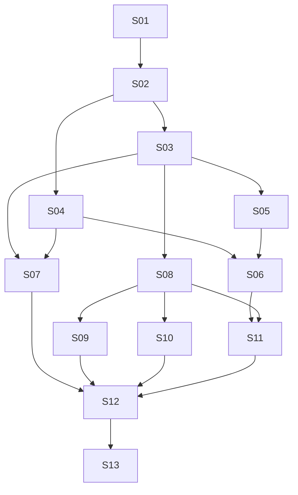

# Standalone Garden v1 — proposed Epic/Story index

**Date:** 2026-10-12 · **Status:** PROPOSED DECOMPOSITION — AWAITING WRITTEN-SPEC APPROVAL

Authoritative design: [specification for user review](../../specs/2026-10-12-garden-standalone-v1-design.md). Decision record: [ADR-0019](../../../architecture/0019-garden-standalone-v1.md). Research baseline: [Stage 1](../../../research/garden-standalone-v1.md), `76baea03e9913b8bfeb35c44cae0a66e4f5eed59`.

This is an outcome/dependency outline, **not executable Story plans, an approved backlog, or a complete implementation planning package**. Every Story is Proposed, none is Ready. No per-Story plan files are created before written-spec approval. Afterwards the architect must supply concrete changes/contracts, verification commands and expected results, refresh caller evidence, resolve applicable owner questions, and obtain implementation-plan review/execution selection. This index owns status/dependency data; the diagram and waves below are derived from the immediate-predecessor column.

## Proposed Epics

| Epic | Coherent outcome | Stories | Design decisions |
| --- | --- | --- | --- |
| E1 — Canonical subjects and governed access | One local owner, distinct subjects/principals, exact grants and all memory entrypoints converged | S01–S03 | D1–D4, D11 |
| E2 — Continuity, backend choice and existing identity | Scope-safe shared Recap, real BML alternate and safe VIVY/DIVA ownership arrangement | S04–S06 | D1, D4, D5, D7 |
| E3 — Explicit experience and host integrations | Selected facts without autonomy, consented host bindings and four-host product support | S07–S10 | D3, D6–D10, D12 |
| E4 — First launch and full management console | Restartable DeepSeek setup/upgrade plus actual state editing and permission/status UX | S11–S12 | D1, D2, D4, D5, D10 |
| E5 — Integrated release evidence and clean break | All proposed acceptance boundaries validated, old executable paths removed and documented | S13 | D1–D12 |

## Proposed Story boundaries and immediate dependencies

All rows have status **Proposed / not Ready**. Acceptance descriptions express future outcomes, not reported passes. Requirement IDs and decision IDs refer to the authoritative specification.

| Story | Independently verifiable outcome and boundary | Immediate predecessors and supplied contracts | Requirements | Acceptance evidence sought |
| --- | --- | --- | --- | --- |
| S01 | Registry and single-owner composition: stable subjects, path identity, shared backend owner and owner-mode/lock lifecycle; no data conversion | — | R1, R10, R12 | Two subject handles share one backend owner; duplicate path/ID refused; second process cannot open owned installation; restart preserves registry. |
| S02 | Unique principals, session/worker binding, exact grants/shares/revoke and owner pairing; no team IAM | S01: subject registry and ownership boundary | R1, R2, R4, R6 | Subject/principal/agent/workspace distinctions exercised; read-only shares and bounded child grants; revoke ordering and forbidden metadata access. |
| S03 | Selected-backend contract, Mentle management reads and convergence of retained HTTP/MCP/embedded memory paths; no unrelated engine enhancement | S02: trusted binding, grants and authorized scope decisions | R2, R3, R5, R11, R12 | All retained CRUD/search/expansion/collection/history/receipt paths use central policy; no raw bypass; writable model-less Mentle gate and canonical/index receipts. |
| S04 | One free-form subject Recap with CAS, source-access union, clear barrier and deferred tool activation contract; coordinated replacement of Work consumers | S02: subject/session grants and worker limits | R2, R4, R5, R8, R11 | Concurrent sessions/edit conflict, restricted projection denial, clear/restart/commit-before-unload; owning-library API consumed by VIVY policy, not a new compactor. |
| S05 | Qualified BML adapter over existing BML module, explicit subject mapping and management/receipt capabilities; no second BML implementation | S03: shared backend and transport conformance contract | R2, R3, R10, R11 | Same contract corpus on BML; multi-subject exact scopes in one DB; explicit legacy mapping preview; missing capabilities block selection. |
| S06 | Existing VIVY/Garden attachment and cross-repo client composition; preserve single VIVY persona and canonical authority; explicit import/takeover | S04: subject Recap contract; S05: qualified alternate and mapping contract (Mentle supplied transitively by S03) | R1, R3, R4, R10, R11 | BML-first VIVY then Mentle-through-DIVA integration; old writer stopped/fenced; shared Persona revisions visible; interrupted handoff safe; independent snapshot clearly distinguished. |
| S07 | Selected evidence-to-fact workflow and standalone autonomy removal; keep shared DIVA mutation/receipt/Mission infrastructure | S03: governed memory mutation/lineage; S04: replacement Recap/Work boundary | R8, R11, R12 | Explicit selected fact persists with provenance/replay; no automatic Persona/rules/skills mutation; caller searches and DIVA receipt tests justify each removal. |
| S08 | Common host consent/config projection, conflict/backup, independent controls and honest saved/written/loaded status | S03: authenticated host-facing memory operations | R2, R6, R7, R10 | Inert discovery/install, separate toggles, compare-before-write, revoke and queued-work denial; no false loaded acknowledgement. |
| S09 | OpenClaw and Hermes native adapters using S08; selected capture/recall and persona sync with version-qualified limits | S08: common binding/projection/status contract | R6, R7, R8 | Both native adapters pass cold/new-session, recall, selected capture, disable/revoke and preservation cases; Hermes cached session distinguished. |
| S10 | Claude Code and Codex CLI instruction-file + explicit MCP adapters; optional hook experiments separately labeled | S08: common binding/projection/status contract | R6, R7, R8 | Both CLIs preserve instructions and hierarchy, use scoped MCP, support explicit selected capture and revocation; hook experiments do not count as committed lifecycle acceptance. |
| S11 | Persisted DeepSeek-only first launch, local secrets, create/attach/skip persona, optional hosts and restartable upgrades | S06: takeover/import and backend availability; S08: inert optional host setup | R3, R9, R10 | Restart each step, complete/skip and no repeat wizard, private secret persistence, failed-key management access, backup/version recovery without reset or hidden migration. |
| S12 | Full console and headless parity for canonical state, history/lineage, permission/share, hosts and health; reuse existing pages | S07: fact flow and clean autonomy boundary; S09: native host statuses; S10: CLI host statuses; S11: setup/upgrade lifecycle (Recap and memory APIs supplied transitively) | R1, R2, R4, R5, R6, R8, R9 | Actual revision editing/clear/history with conflicts; source permissions; share/revoke; provider degradation; distinct saved/written/loaded; no UI-owned authority. |
| S13 | Integrated acceptance, release packaging and final removal audit; update superseded current contracts without rewriting historical evidence | S12: integrated product surfaces and all predecessor contracts | R1–R12 | Spec §10 matrix across both backends and four hosts, one-writer takeover/recovery, BML-first and owner DIVA evidence; zero unowned legacy bypass/autonomy wiring in standalone artifact. |

S03 removes memory bypasses when replacing them; S07 removes autonomy paths when disentangling them; S13 verifies removal rather than postponing deletion indefinitely. Each Story includes its necessary focused documentation/tests/packaging. No separate ceremonial “setup”, “write tests” or “update status” Stories are created.

## Dependency graph and waves

| Topological wave | Proposed Stories | Meaning |
| --- | --- | --- |
| 0 | S01 | Ownership/registry foundation |
| 1 | S02 | Trusted identity and policy |
| 2 | S03, S04 | Memory boundary and Recap contracts |
| 3 | S05, S07, S08 | Alternate backend, explicit facts/cleanup, host core |
| 4 | S06, S09, S10 | Existing identity handoff and concrete hosts |
| 5 | S11 | Setup/upgrade integrates handoff and host options |
| 6 | S12 | Full management integration |
| 7 | S13 | Release acceptance and clean-break audit |

These are logical orderings, not authorization for parallel agents or an estimate. UI layout exploration can occur earlier after design approval, but S12's end-to-end evidence consumes implemented predecessor contracts. File conflicts are separate: S03/S04/S07 touch `garden/agentapi` and server contracts; S01/S03/S06/S11 share composition/config; S08–S12 share console shell/API/types; S04/S06/S07 cross VIVY cognitive DTOs and shared DIVA effects. Sequence these edits or use isolated worktrees and agreed interface revisions after execution is authorized. Do not assume a DAG wave eliminates merge conflicts.

## External dependencies and owner gates

| Gate | Owner/evidence | Affected Stories and exact needed outcome |
| --- | --- | --- |
| X1 | Laputa #1/#7; spec §5 | S03: writable no-embedding Mentle and useful Chinese lexical behavior; same backend contract/health. Reuse their work; do not absorb unrelated retrieval/graph/media batches. |
| X2 | VIVY #57/#58 and accepted ADR-0018 | S04/S06: session/worker grants, subject Recap admission/coverage and LIFE-first/CODE-negative tests in the existing unified pipeline; shared Work/DTO callers reconciled before removal. |
| X3 | VIVY BML maintainers, existing `bml` module | S05/S06: subject mapping, one-DB multi-subject storage, canonical receipts/history/expansion and supported module version; no adapter-only claim over missing semantics. |
| X4 | Exact host releases and installed test environments | S09/S10: pin versions/API surfaces and prove committed matrix; experimental hooks may remain experimental. Unavailable host evidence remains blocked, never a pass. |
| X5 | Owner review Q1–Q5 in spec | All: written-spec approval first; Q1/Q2 materially affect ownership/backend scope, Q3 Recap behavior, Q4 host commitment, Q5 initial OS/secret acceptance. Resolve before affected Story plans can become Ready. |

## Requirement coverage

| Requirement | Primary coverage | Integration acceptance |
| --- | --- | --- |
| R1 | S01, S02, S06, S12 | S13 |
| R2 | S02, S03, S04, S05, S08, S12 | S13 |
| R3 | S03, S05, S06, S11 | S13 |
| R4 | S02, S04, S06, S12 | S13 |
| R5 | S03, S04, S12 | S13 |
| R6 | S02, S08, S09, S10, S12 | S13 |
| R7 | S08, S09, S10 | S13 |
| R8 | S04, S07, S09, S10, S12 | S13 |
| R9 | S11, S12 | S13 |
| R10 | S01, S05, S06, S08, S11 | S13 |
| R11 | S03, S04, S05, S06, S07 | S13 |
| R12 | S01, S03, S07 | S13 |

## Evidence and current state

Stage 1 remains unchanged and precedes this documentation commit. Stage 2 source checks and design rationale are in the specification; implementation evidence is absent by design. Documentation validation checks relative targets/anchors, existing source paths, requirement IDs, dependency references, no self-edges/cycles/redundant transitive edges, graph/table/wave agreement and `git diff --check`. Application suites are intentionally not run for documentation-only work. Remote branch/commit verification belongs to the delivery response; no mutable branch link is treated as a runtime acceptance artifact.

The next action is owner review of the written specification. No Story execution is available from this index.
