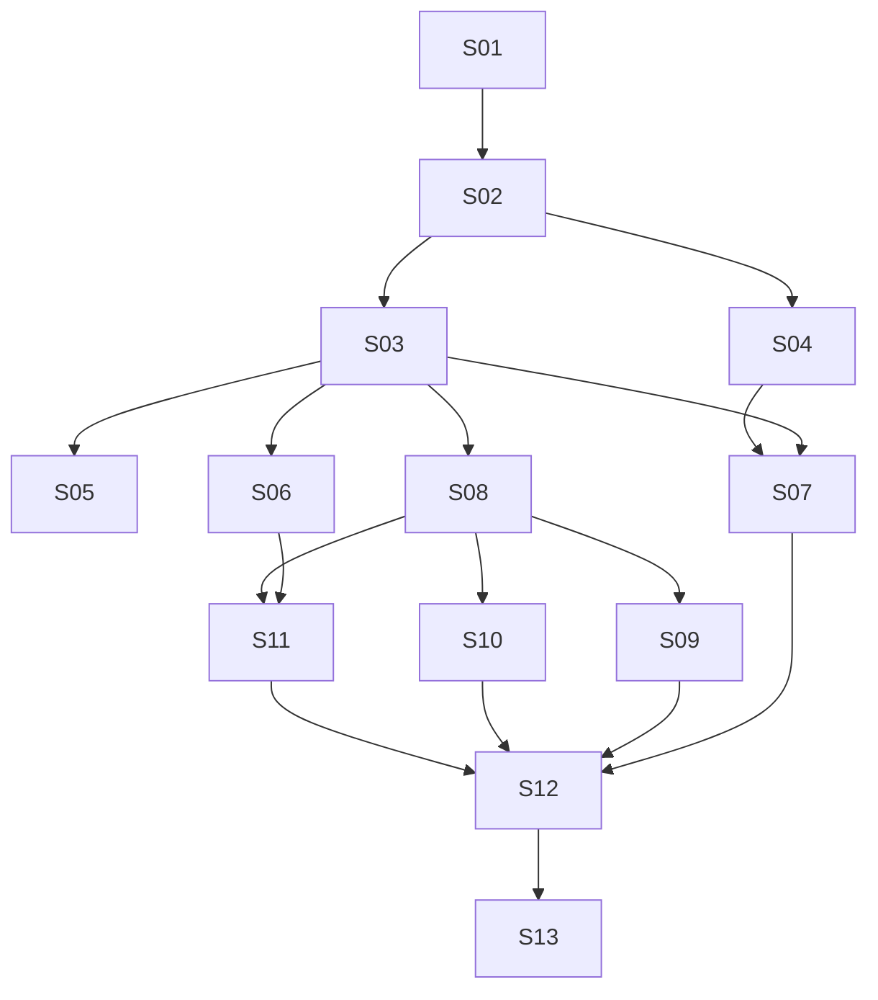

# Standalone Garden v1 — authoritative Epic/Story plan index

**Date:** 2026-10-12 · **Status:** UNBLOCKED PLANS APPROVED 2026-10-12 13:13 UTC — NATIVE IMPLEMENTATION IN PROGRESS

Authoritative design: [specification for user review](../../specs/2026-10-12-garden-standalone-v1-design.md). Decision record: [ADR-0019](../../../architecture/0019-garden-standalone-v1.md). Research baseline: [Stage 1](../../../research/garden-standalone-v1.md), `76baea03e9913b8bfeb35c44cae0a66e4f5eed59`.

The owner development assignment on 2026-10-12 authorizes advancing the delivered written architecture into concrete Story planning and publishing those plans on `feat/garden-standalone-v1`. It does **not** approve plans that did not exist, resolve Q2/Q3, authorize runtime changes, or authorize changes in other repositories. The 13 linked plans below now specify files, consumed/produced interfaces, focused tasks, verification and removal. The four unblocked plans were approved for execution; nine remain Blocked for the exact decisions/evidence listed below, with independent tasks separated where useful. Owner approved starting S01/S02/S03/S08 on 2026-10-12 13:13 UTC; Q2/Q3 and the blocked rows remain unresolved.

The preserved execution choice is one development session on GPT-6.1-SOL HIGH using `superpowers:executing-plans` after parent/owner review; do not ask to rechoose the model or create per-task implementer agents. This index is the sole owner of status and immediate dependency data; the graph and waves derive from the predecessor column. A plan being reviewable does not satisfy its unimplemented predecessors. Review approval promotes only unblocked plans; execution starts with S01 after that gate. Native tests now supply the evidence recorded below; real user host configuration/data transfer remain unauthorized.

## Scope reconciliation and independently accepted increments

[Issue #8](https://github.com/ProjectViVy/laputa/issues/8), created before this task and missed in the first overlap audit, owns the lean Mentle private/shared-memory slice. The specification §1.3 records the correction and conflicts. This index no longer makes BML qualification, the new Recap format or optional subsystem rewrites prerequisites for that slice. Existing `ProfileID` stays the subject identifier; sharing uses named resource membership with read/read_write access. No issue text authorizes execution.

- **M0 — lean private/shared slice:** S01–S03, including minimal reused UI/API for active profile, private/shared location, membership and removal. Use a working Mentle installation and existing scoped ACTMEM. It can be reviewed/accepted before S04–S13; no backend switch or automatic private publication.
- **M1 — broader standalone management:** S04, S06–S13 add the separately requested continuity, supported Mentle ownership handoff, explicit facts/autonomy cleanup, four hosts and full wizard/UI. The graph does not block this path on S05. Any interim release must say R3 alternate-backend delivery and BML-backed attachment are pending.
- **M2 — qualified alternate:** S05 delivers the real BML backend and verifies its applicable UI/client/attachment paths once those consumers exist. It is required for the broader backend goal, not M0. Q2 decides whether M1 and M2 must share a release date. No full-scope completion claim is possible while either remains incomplete.

These are proposed acceptance boundaries, not approved release dates or reduced product scope. Full UI, opted-in host features, safe secrets and canonical VIVY identity remain required by the main task.

## Epics

| Epic | Coherent outcome | Stories | Design decisions |
| --- | --- | --- | --- |
| E1 — Canonical subjects and governed access | Trusted local owner, existing profiles, named shared spaces and all enabled memory paths governed | S01–S03 | D1–D4, D11 |
| E2 — Continuity, backend choice and existing identity | Subject Recap, independently qualified BML alternate and safe existing-identity ownership | S04–S06 | D1, D4, D5, D7 |
| E3 — Explicit experience and host integrations | Selected facts without autonomy, consented host bindings and four-host product support | S07–S10 | D3, D6–D10, D12 |
| E4 — First launch and full management console | Restartable DeepSeek setup/upgrade plus actual state editing and permission/status UX | S11–S12 | D1, D2, D4, D5, D10 |
| E5 — Integrated release evidence and clean break | All proposed acceptance boundaries validated, old executable paths removed and documented | [S13](S13.md) | D1–D12 |

## Story plans and immediate dependencies

Readiness is recorded in the table after this dependency table. Acceptance descriptions express future outcomes, not reported passes. Requirement IDs and decision IDs refer to the authoritative specification. The logical DAG remains 13 nodes / 17 immediate edges / 7 waves; blockers are gates, not invented prerequisite edges.

| Story | Independently verifiable outcome and boundary | Immediate predecessors and supplied contracts | Requirements | Acceptance evidence sought |
| --- | --- | --- | --- | --- |
| [S01](S01.md) | Reuse ProfileID registry and local single-owner composition; share existing memory resources; no data conversion or distributed ownership layer | — | R1, R10, R12 | Distinct profile handles share one service; path/ID conflict refused; supported concurrent writer refused; restart preserves binding. |
| [S02](S02.md) | Trusted host credential/profile binding and named shared-space membership read/read_write; bounded workers via existing handles | S01: profile registry and local owner boundary | R1, R2, R4, R6 | A/B/C private/shared rights and membership removal; body IDs/role token cannot widen access; no arbitrary private grants or capability delegation. |
| [S03](S03.md) | Complete Mentle private/shared vertical slice across enabled explicit and automatic memory paths, capture/retry and minimal reused UI; no optional subsystem rewrite | S02: trusted binding and membership resolution | R2, R3, R5, R11, R12 | Issue #8 focused A/B/S/C scenarios; participants/read-write controls; stale evidence/context denial, useful Chinese queries, CAS/receipts; optional unsafe multi-persona surfaces explicitly unavailable. R3 covers the Mentle baseline only. |
| [S04](S04.md) | Broader subject Recap/CAS/clear/deferred-tools work, with Q3-reviewed personal-only contribution policy or approved alternative; no mandatory source-union system | S02: bound profile/session access | R2, R4, R5, R8, R11 | Same-subject revision stream, restricted-session and worker denial, concurrent edit/clear/restart, commit-before-unload; coordinate #58 Work consumers without blocking M0. |
| [S05](S05.md) | Independent BML qualification over its existing module: explicit ProfileID mapping, canonical receipts and necessary management reads; no new BML implementation | S03: backend/binding conformance baseline | R2, R3, R10, R11 | Actual multi-profile one-DB adapter and explicit legacy mapping; conformance before selection. Validate supported consumer/attachment integration when available; broader R3 remains pending until this lane completes. |
| [S06](S06.md) | Supported existing Mentle-backed VIVY/Garden client attachment and explicit local owner handoff; preserve actual identity/data and current Recap format | S03: bound memory service and Mentle contract | R1, R3, R10, R11 | Same authoritative persona/revisions, stopped prior writer, minimal local lock/config, safe interrupted handoff. BML-backed attachment is unavailable until qualified in S05; no silent conversion or dual owner. |
| [S07](S07.md) | Selected evidence-to-fact and standalone autonomy removal; explicit selected shared writes only, no automatic publication or taint/declassification machinery | S03: governed mutations/lineage; S04: coordinated Recap/Work replacement | R8, R11, R12 | Private capture stays private; human-selected shared fact and operation-scoped source provenance work; shared DIVA receipts/Mission contracts survive justified cleanup. |
| [S08](S08.md) | Common consented host binding/projection, conflict/backup, independent controls and saved/written/loaded status | S03: authenticated host-facing memory operations | R2, R6, R7, R10 | Inert discovery/install, separate controls, compare-before-write, revoke and queued-write recheck; no false loaded state. |
| [S09](S09.md) | OpenClaw and Hermes native adapters using S08; selected capture/recall and persona sync with version-qualified limits | S08: common binding/projection/status contract | R6, R7, R8 | Both native adapters pass cold/new-session, recall, selected capture, disable/revoke and preservation cases; Hermes cached session distinguished. |
| [S10](S10.md) | Claude Code and Codex CLI instruction-file + explicit MCP adapters; optional hook experiments separately labeled | S08: common binding/projection/status contract | R6, R7, R8 | Both CLIs preserve instructions and hierarchy, use scoped MCP, support explicit selected capture and revocation; hook experiments do not count as committed lifecycle acceptance. |
| [S11](S11.md) | DeepSeek-only persisted setup, private host secrets, create/attach/skip, optional hosts and safe upgrades; smallest writable model-less Mentle delta | S06: supported takeover/client/ownership checkpoints; S08: inert optional host setup | R3, R9, R10 | Resume/complete without repeated wizard, private credentials, key failure and backup recovery; BML choice/attachment honestly unavailable until qualification. |
| [S12](S12.md) | Full human console/headless parity: real Persona/Recap/memory/history/lineage, shared-space membership, hosts and health; reuse existing pages | S07: fact/Recap and cleanup contracts; S09: native host status; S10: CLI host status; S11: setup/upgrade | R1, R2, R4, R5, R6, R8, R9 | Actual revisions/conflicts, read/read_write participants, source visibility, provider status and saved/written/loaded. Required UI remains complete even when optional agent graph/trace is unavailable. |
| [S13](S13.md) | Integrated acceptance of delivered M1 surfaces and removal audit, with precise residual backend status; not an optional hardening project | S12: integrated management/host/setup surfaces | R1–R12 (R3 alternate acceptance remains with S05) | Focused spec §10 cases, supported local ownership and four hosts; reuse BML-first VIVY and owner Mentle-through-DIVA evidence. No full backend-choice claim without M2; preserve useful single-persona features. |

S03 removes memory bypasses when replacing them; S07 removes autonomy paths when disentangling them; S13 verifies removal rather than postponing deletion indefinitely. Each Story includes its necessary focused documentation/tests/packaging. No separate ceremonial “setup”, “write tests” or “update status” Stories are created.

## Dependency graph and waves

| Topological wave | Stories | Meaning |
| --- | --- | --- |
| 0 | [S01](S01.md) | Ownership/registry foundation |
| 1 | [S02](S02.md) | Trusted identity and policy |
| 2 | S03, S04 | Memory boundary and Recap contracts |
| 3 | S05, S06, S07, S08 | Independent backend lane, Mentle attachment, facts/cleanup, host core |
| 4 | S09, S10, S11 | Concrete hosts and setup/upgrade |
| 5 | [S12](S12.md) | Full management integration |
| 6 | [S13](S13.md) | Scoped integration acceptance and clean-break audit |

These are logical orderings, not authorization for parallel agents or an estimate. S05 is a separate branch of the DAG: its appearance in a wave does not make completion a barrier for the M1 path. Its final backend qualification must include consumer integration where offered; an adapter-only test pass is insufficient. UI layout exploration can occur earlier after design approval, but S12's end-to-end evidence consumes implemented predecessor contracts. File conflicts are separate: S03/S04/S07 touch `garden/agentapi` and server contracts; S01/S03/S06/S11 share composition/config; S08–S12 share console shell/API/types; S04/S06/S07 cross VIVY cognitive DTOs and shared DIVA effects. Sequence these edits or use isolated worktrees and agreed interface revisions after execution is authorized. Do not assume a DAG wave eliminates merge conflicts.

## Review readiness and smallest decisions

| Story | Plan state | Remaining gate beyond predecessor delivery |
| --- | --- | --- |
| S01 | Implemented foundation / final review pending | Shared-owner/profile/Frozen tests and Garden suite PASS; main listener cutover deferred to S03 closure (recorded execution ruling). |
| S02 | Implemented / final review pending | Trusted host bindings, owner pairing/cookie/origin, read/read_write membership and current revocation tests PASS; multi-persona data listener closure belongs to S03. |
| S03 | Implemented Mentle slice / final review pending | Task 1 `e12a9d0`; full Garden and scoped Mentle suites, native/lexical Chinese corpus, focused race suites, HTTP matrix, capture origin/restart/revocation and browser A/B/shared create/removal PASS. Q3 automatic Recap/cognition inputs remain unwired. |
| S04 | Blocked | Q3 approved mixed-source/restricted-session Recap policy + coordinated live Work/desktop DTO cutover. Authority mechanics independently reviewable; no new consolidation enabled. |
| S05 | Blocked | Reviewed/authorized BML provider-owned schema/public API and explicit legacy mapping on dedicated VIVY branch; final offered UI/client/setup consumers must qualify. Q2 does not block planning this lane. |
| S06 | Blocked | Q1/Q5 initial supported local attachment/package + versioned other-machine export/import grammar; supported VIVY client/lock composition on authorized dedicated consumer branch. |
| S07 | Blocked | S04/Q3 coordinated Work replacement; selected source-linked fact task independently reviewable without accepting Q3. |
| S08 | Implemented common host core / final review pending | Owner apply/status/revoke and authenticated loaded-ack ingress, stable errors, restart/source-head/control/file preservation tests and focused race suites PASS. No native loaded-evidence adapter or external-host configuration qualified. |
| S09 | Blocked | X4 pinned OpenClaw/Hermes releases, exact SDK signatures and installed isolated-host evidence; four-host commitment unchanged. |
| S10 | Blocked | X4 pinned Claude Code/Codex CLI floors and exact config/discovery syntax; files + explicit MCP stable, lifecycle hooks experimental. |
| S11 | Blocked | Q5 target OS/package/private-permission implementation and S06 attachment support; candidate DeepSeek model needs release/account validation, no new provider chooser. |
| S12 | Blocked | Q3/S04 Recap contract and all required predecessor evidence; history/UI tasks independent in design but full Story cannot claim ready. |
| S13 | Blocked | Integrated predecessor/host/package/Recap evidence; Q2 needed only for final release timing/completion claim. S05 qualification still required for full R3. |

Only two policy choices need early owner attention: **Q3** (recommend personal-only contribution/admission excluding shared/restricted sessions, still unapproved) and **Q2** (recommend independent Mentle delivery with BML qualification still required; full-release timing unapproved). Q2 does not stop independent development. Q1/Q5 become necessary before S06/S11: recommend owner-selected local Mentle takeover first, an explicit versioned transfer format for other machines, and one confirmed local OS/package with private host secret storage. Native version floors should be researched and recommended against actual available host builds before asking the owner to choose; do not ask four broad version questions now. Cross-repo writes are separate authorization, not implicit plan publication permission.

## Shared contract ownership and file coordination

Read the owning Interfaces block rather than inventing a duplicate contract file:

| Contract owner | Produced contract | Direct consumers / coordination |
| --- | --- | --- |
| [S01](S01.md) | Installation/Profile/ClientConfig, shared Owner, exact SessionKey and ownership locks | S02; S03/S06/S11 reach composition through their predecessors. |
| [S02](S02.md) | HostBinding/HostControls, current Resolve/ResolvedAccess/MembershipKey, shared membership, owner cookie/pairing | S03/S04; S08 references unchanged controls through S03. |
| [S03](S03.md) | Governed Backend view, MemoryTarget, ManagementBackend/Record/ListRequest, per-row capture identity | S05/S06/S07/S08; S12 history extends this model. |
| [S04](S04.md) | Laputa Recap CAS/generation/coverage/receipt/history and Q3-reviewed host admission | S07/S12; VIVY unified context and DIVA Work consumers coordinate on same revision. |
| [S05](S05.md) | Proposed provider-owned GardenStore API and thin BML mapping | Separate BML qualification lane; consumer acceptance uses S06/S11/S12 evidence when offered, not new DAG edges. |
| [S06](S06.md) | AttachService checkpoints and RemoteClient, explicit supported VIVY client mode | S11; no local DB reopen in attached mode. |
| [S07](S07.md) | SelectedExperience/FactDraft/SaveFact, optional operation-scoped SourceMutationBackend | S12; optional model drafting uses S11 Provider, manual save remains independent. |
| [S08](S08.md) | FilePlan/HostStatus and compare/backup/loaded/revoke service | S09/S10/S11. |
| [S11](S11.md) | State/SetupChoice/ProviderStatus/SecretStore and minimal optional generation port | S12; optional S07 drafting, no new dependency for manual facts. |
| [S12](S12.md) | HistoryBackend/RevisionQuery/RevisionPage, actual owner console/API parity | S13; S05 offered full-history qualification consumes these semantics. |

Sequence shared files within this one executor; a DAG wave is not a parallel edit mandate. S01/S03/S06/S11 share owner/main; S02/S03/S04/S07 share agentapi/server; S08–S12 share host APIs/UI; S03/S11/S12 share Mentle canonical/receipt files. Refresh source/diff before each task and preserve concurrent changes. No extra worktree/branch was created: the selected environment has a clean dedicated checkout, switched to the fetched existing branch for authorized documentation work. Runtime worktree setup/verification follows using-git-worktrees at the later execution gate.

## External dependencies and owner gates

| Gate | Owner/evidence | Affected Stories and exact needed outcome |
| --- | --- | --- |
| X1 | Laputa #1/#7/#8; spec §5 | S03 uses a working Mentle composition and checks representative retrieval. S11 needs the smallest writable no-embedding setup delta. Do not gate sharing on the full enhancement backlog or a speculative index rewrite. |
| X2 | VIVY #57/#58 and accepted ADR-0018 | S04/S07: existing session/worker access, Q3-reviewed Recap admission/coverage and LIFE-first/CODE-negative tests in the existing unified pipeline; shared Work/DTO callers reconciled before removal. |
| X3 | VIVY BML maintainers, existing `bml` module | S05: explicit ProfileID mapping, one-DB multi-profile storage, receipts and required reads. BML-backed attachment waits on qualification; Mentle attachment in S06 and M0 do not. |
| X4 | Exact host releases and installed test environments | S09/S10: pin versions/API surfaces and prove committed matrix; experimental hooks may remain experimental. Unavailable host evidence remains blocked, never a pass. |
| X5 | Owner review Q1–Q5 in spec | Planning is authorized; implementation-plan review still required. Q2/Q3 remain unresolved. Q1/Q5 block concrete attachment/packaging/secret implementation in S06/S11; Q4 four-host matrix is preserved, only exact stable/experimental version floors block S09/S10. Do not re-ask settled product scope or gate independent Stories on unrelated decisions. |

## Requirement coverage

| Requirement | Primary coverage | Integration acceptance |
| --- | --- | --- |
| R1 | S01, S02, S06, S12 | [S13](S13.md) |
| R2 | S02, S03, S04, S05, S08, S12 | [S13](S13.md) |
| R3 | S03, S05, S06, S11 | S05 alternate qualification; S13 reports delivered baseline and any residual gap |
| R4 | S02, S04, S12 | [S13](S13.md) |
| R5 | S03, S04, S12 | [S13](S13.md) |
| R6 | S02, S08, S09, S10, S12 | [S13](S13.md) |
| R7 | S08, S09, S10 | [S13](S13.md) |
| R8 | S04, S07, S09, S10, S12 | [S13](S13.md) |
| R9 | S11, S12 | [S13](S13.md) |
| R10 | S01, S05, S06, S08, S11 | [S13](S13.md) |
| R11 | S03, S04, S05, S06, S07 | [S13](S13.md) |
| R12 | S01, S03, S07 | [S13](S13.md) |

## Evidence and current state

Planning baseline verified against remote `feat/garden-standalone-v1` head `3f14f8f4135790591e746d78058314ca9a46551b`; local runtime remains main baseline `f44ba00eb6ab5aa6ab9a2f5c09868373e36679f5`. VIVY local source inspected at `65b561f6f8189dc36dd29120a6f8a5f20b7071a6`; DIVA source at `0a64d1ce152440f1f63d4224a155c4616d2aff5b`. Issue #8 fetched read-only and reconciled, no tracker changes. Refresh cross-repo heads before any later authorized edits; these are inspection pins, not current-host/runtime certification.

Source findings reflected in plans: single ProfileID construction; shared state Frozen Core keyed only by session_id; globally unique ingest event_id; role/loopback auth and raw Facade/DeepRecall/collection/MCP bypasses; Mentle audit/receipts lacking old content snapshots; BML tenant/workspace without persona dimension; live VIVY DIVA Work/Domain/receipt/Mission consumers. Existing paths verified, proposed/new/predecessor-produced paths labelled. Exact DIVA cognitive DTO/state/view/locale callers are mapped in S04; known-owner Frozen/capture key preservation during handoff is mapped in S06. No supplied host binary or SDK version was certified.

Writing-plans self-review completed against specification §§1–10: R1–R12 and D1–D12 mapped to owning tasks; current/produced API names reconciled; five failure classes per plan mapped to focused tests; removal tasks included with replacement, historical evidence preserved. Blocked plans explicitly name missing policy/version/schema/parser contracts rather than pretend executable certainty. Plan suite is 13 concise subsystem plans, not expanded pseudocode or a second delivery framework. Supplemental Supermanagement reference files were requested via skills.read but unavailable in the provided package; its available SKILL.md and writing-plans contract were followed. Applicable repository instructions and VIVY .agents/skills/vivy-eino integration reference were inspected for cross-repo planning.

Documentation-only validation **PASS** (2026-10-12): 13 plans, 17 edges, 7 waves, 4 Ready-for-review / 9 Blocked; 115 existing source paths and 102 proposed source/artifact paths classified; 20 cross-Story contract-owner symbols checked alongside manual type/step review. Checked owned Markdown relative links/anchors and existing/proposed path classification; required plan header/interfaces/checkbox tasks and focused commands; 13 Story IDs, known endpoints/no self-edges/no cycles/no redundant transitive edges; 17 graph edges and 7 table/graph/wave agreement; cross-Story contract owner references; `git diff --check`; changed files confined to docs. No Go/console/host/model runtime suites run or acceptance evidence manufactured. Remote recheck/commit/push verification is reported with the delivery commit.

Execution authorization received 2026-10-12 13:13 UTC: start the unblocked plans in the same GPT-6.1-SOL HIGH/native session. The writing-plans review gate is satisfied. Next: S02, then S03 and S08 once each predecessor passes. Q2/Q3 and concrete attachment/host/package gates stay open.

### Observed S01 implementation evidence

- Task 1 `8591dba`: profile registry/path identity and exclusive resource locks. Profile missing-API RED; subprocess no-lock/partial-lock RED; `go test ./internal/registry ./internal/runtimecore -run 'Test(Profile|SessionKey|OwnerLock)' -count=1` and full package suites PASS.
- Task 2: one installation resource owner, lightweight subject clients, persisted host-qualified Frozen keys, bound enumeration/cleanup and lifecycle gates. Installation missing-API RED; cleanup showed foreign session keys before fix; focused and full `./agentapi ./internal/runtimecore ./internal/personactx ./internal/registry` suites PASS.
- `cd garden && GOSUMDB=off go test ./...` PASS using repository-pinned Go 1.26.4. Baseline console `pnpm build` PASS. Runtime main cutover intentionally paired with S03 complete auth/route closure; no multi-profile listener exposed early.
- Worktree `/workspace/laputa-garden` uses the existing branch. Workflow helper scripts unavailable; prescribed brief/BASE/RED→GREEN/ledger records maintained manually under ignored `.superpowers/sdd/<Story>`. Test/toolchain caches are outside repository; provider archive fallback verified against unchanged go.sum. No user environment/production data/configuration touched.
- Whole approved-scope independent review remains pending; do not treat green tests alone as final acceptance.

### Observed S02 implementation evidence

- Opaque per-host digest credentials; stable internal trusted bindings; host creation inactive; separate three controls and role operation ceilings. Owner-only profile/share/binding APIs use one-use local pairing and HttpOnly/SameSite owner cookie with mutation Origin checks. No browser bearer token input/storage code.
- Named shared-space read/read_write and no foreign private grants; current membership digest invalidates revoked views. Workers have no automatic Persona/Recap/search; explicit selected-source expansion is constrained. No IAM/delegation/taint framework.
- Missing APIs RED → focused auth/membership tests GREEN; duplicate same-profile host/session IDs RED → real BindingID Frozen namespace GREEN; initially active creation RED → inactive creation + explicit control enable GREEN. `go test ./internal/registry ./agentapi ./internal/server -count=1`, Garden `go test ./...`, and console `pnpm build` PASS.
- New installation control plane denies role-token/loopback auth. S03 will perform the atomic data-handler/main cutover and remove raw memory bypasses; S02 alone is not end-to-end memory isolation acceptance.
