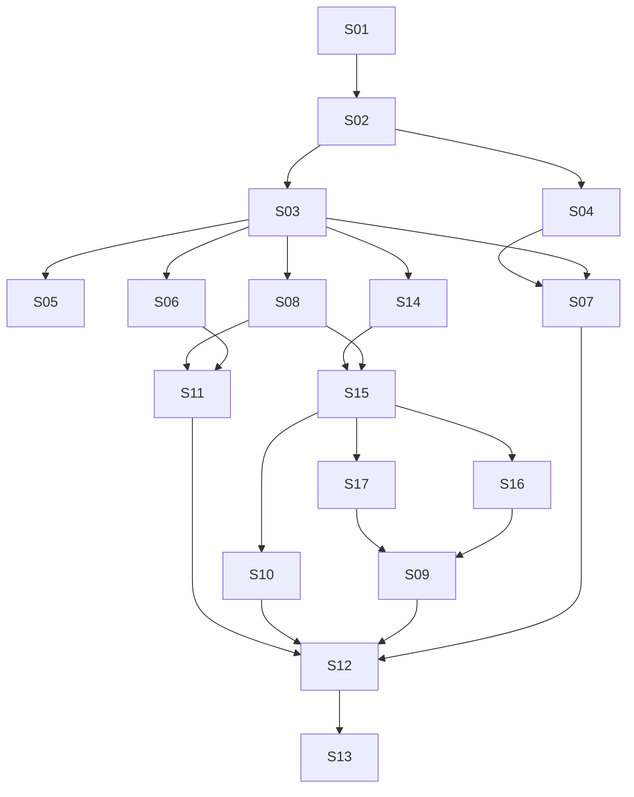

# Standalone Garden v1 — authoritative Epic/Story plan index

**Date:** 2026-10-12 · **Status:** S14/S15 IMPLEMENTED AND INDEPENDENTLY RECHECKED; S16 IN PROGRESS; ACTUAL HOST DELIVERY PENDING

Authoritative design: [specification](../../specs/2026-10-12-garden-standalone-v1-design.md). Decision record: [ADR-0019](../../../architecture/0019-garden-standalone-v1.md). Increment evidence: [controlled-editing research](../../../research/garden-standalone-v1-controlled-editing-research-2026-10-12.md), [exact host pins](../../../research/garden-host-pins-2026-10-12.md), [spec/plan review and handoff](controlled-editing-review.md). Runtime baseline is `3c4cfffe33d92ad1105ad31dec259c901cc24a4e` on `feat/garden-standalone-v1`.

The owner authorized continuing the Garden enhancement, detailed architecture, Supermanagement Epic/Story plans, review and documentation publication on this same branch. This planning session changes documents only. S01/S02/S03 and conservative S08 are already implemented; their historical evidence below remains intact. The original automatic dynamic-update requirement is retained and assigned to S14–S17 and revised S10, not satisfied by editor locks or manual file copying. S09 retains native memory completion; unrelated Q2/Q3 and cross-repository writes are not newly authorized.

Preserve the original GPT-6.1 Sol High native development session using `superpowers:executing-plans`; do not rechoose model/method or dispatch per-task implementers. This index alone owns status and immediate dependencies. First execute **S14 → S15 → S16**, then S17 and S10 sequentially in that executor; S09 follows its exact memory SDK mapping gate. First actual automatic-host acceptance is S16, not S14/S15 alone. A ready plan is not runtime evidence or permission to modify real user host configurations.

## Scope reconciliation and independently accepted increments

[Issue #8](https://github.com/ProjectViVy/laputa/issues/8), created before this task and missed in the first overlap audit, owns the lean Mentle private/shared-memory slice. The specification §1.3 records the correction and conflicts. This index no longer makes BML qualification, the new Recap format or optional subsystem rewrites prerequisites for that slice. Existing `ProfileID` stays the subject identifier; sharing uses named resource membership with read/read_write access. No issue text authorizes execution.

- **M0 — lean private/shared slice:** S01–S03, including minimal reused UI/API for active profile, private/shared location, membership and removal. Use a working Mentle installation and existing scoped ACTMEM. It can be reviewed/accepted before S04–S13; no backend switch or automatic private publication.
- **M1 — broader standalone management:** S04, S06–S17 add the separately requested continuity, supported Mentle ownership handoff, explicit facts/autonomy cleanup, four hosts and full wizard/UI. The graph does not block this path on S05. Any interim release must say R3 alternate-backend delivery and BML-backed attachment are pending.
- **M2 — qualified alternate:** S05 delivers the real BML backend and verifies its applicable UI/client/attachment paths once those consumers exist. It is required for the broader backend goal, not M0. Q2 decides whether M1 and M2 must share a release date. No full-scope completion claim is possible while either remains incomplete.

These are proposed acceptance boundaries, not approved release dates or reduced product scope. Full UI, opted-in host features, safe secrets and canonical VIVY identity remain required by the main task.

## Epics

| Epic | Coherent outcome | Stories | Design decisions |
| --- | --- | --- | --- |
| E1 — Canonical subjects and governed access | Trusted local owner, existing profiles, named shared spaces and all enabled memory paths governed | S01–S03 | D1–D4, D11 |
| E2 — Continuity, backend choice and existing identity | Subject Recap, independently qualified BML alternate and safe existing-identity ownership | S04–S06 | D1, D4, D5, D7 |
| E3 — Explicit experience and host integrations | Selected facts without autonomy, consented host bindings and four-host product support | S07–S10 | D3, D6–D10, D12 |
| E4 — First launch and full management console | Restartable DeepSeek setup/upgrade plus actual state editing and permission/status UX | S11–S12 | D1, D2, D4, D5, D10 |
| E5 — Integrated release evidence and clean break | All proposed acceptance boundaries validated, old executable paths removed and documented | [S13](S13.md) | D1–D15 |
| E6 — Controlled editing and automatic Persona delivery | Lease-aware human editing, fresh retry and actual native prompt updates | S14–S17; revised S10 supplies CLI delivery | D13–D15 |

## Story plans and immediate dependencies

Readiness is recorded in the table after this dependency table. Acceptance descriptions express future outcomes, not reported passes. Requirement IDs and decision IDs refer to the authoritative specification. The logical DAG is 17 nodes / 23 immediate edges / 9 waves; blockers are gates, not invented prerequisite edges.

| Story | Independently verifiable outcome and boundary | Immediate predecessors and supplied contracts | Requirements | Acceptance evidence sought |
| --- | --- | --- | --- | --- |
| [S01](S01.md) | Reuse ProfileID registry and local single-owner composition; share existing memory resources; no data conversion or distributed ownership layer | — | R1, R10, R12 | Distinct profile handles share one service; path/ID conflict refused; supported concurrent writer refused; restart preserves binding. |
| [S02](S02.md) | Trusted host credential/profile binding and named shared-space membership read/read_write; bounded workers via existing handles | S01: profile registry and local owner boundary | R1, R2, R4, R6 | A/B/C private/shared rights and membership removal; body IDs/role token cannot widen access; no arbitrary private grants or capability delegation. |
| [S03](S03.md) | Complete Mentle private/shared vertical slice across enabled explicit and automatic memory paths, capture/retry and minimal reused UI; no optional subsystem rewrite | S02: trusted binding and membership resolution | R2, R3, R5, R11, R12 | Issue #8 focused A/B/S/C scenarios; participants/read-write controls; stale evidence/context denial, useful Chinese queries, CAS/receipts; optional unsafe multi-persona surfaces explicitly unavailable. R3 covers the Mentle baseline only. |
| [S04](S04.md) | Broader subject Recap/CAS/clear/deferred-tools work, with Q3-reviewed personal-only contribution policy or approved alternative; no mandatory source-union system | S02: bound profile/session access | R2, R4, R5, R8, R11 | Same-subject revision stream, restricted-session and worker denial, concurrent edit/clear/restart, commit-before-unload; coordinate #58 Work consumers without blocking M0. |
| [S05](S05.md) | Independent BML qualification over its existing module: explicit ProfileID mapping, canonical receipts and necessary management reads; no new BML implementation | S03: backend/binding conformance baseline | R2, R3, R10, R11 | Actual multi-profile one-DB adapter and explicit legacy mapping; conformance before selection. Validate supported consumer/attachment integration when available; broader R3 remains pending until this lane completes. |
| [S06](S06.md) | Supported existing Mentle-backed VIVY/Garden client attachment and explicit local owner handoff; preserve actual identity/data and current Recap format | S03: bound memory service and Mentle contract | R1, R3, R10, R11 | Same authoritative persona/revisions, stopped prior writer, minimal local lock/config, safe interrupted handoff. BML-backed attachment is unavailable until qualified in S05; no silent conversion or dual owner. |
| [S07](S07.md) | Selected evidence-to-fact and standalone autonomy removal; explicit selected shared writes only, no automatic publication or taint/declassification machinery | S03: governed mutations/lineage; S04: coordinated Recap/Work replacement | R8, R11, R12 | Private capture stays private; human-selected shared fact and operation-scoped source provenance work; shared DIVA receipts/Mission contracts survive justified cleanup. |
| [S08](S08.md) | Conservative common binding/manual-file core; existing-file preservation and separate cleanup | S03: authenticated host operations | R2, R6, R7, R10 | No-clobber missing-file create; existing-file manual apply; revoke preserves user bytes; no false loaded. Native automation belongs to E6. |
| [S09](S09.md) | Native memory recall/selected capture and combined OpenClaw/Hermes qualification in the same packages | S16: OpenClaw native Persona package; S17: Hermes native Persona package | R6, R7, R8, U7 | Exact memory SDK mapping, independent controls and actual selected capture/recall; no second plugin or Persona file writer. |
| [S10](S10.md) | Claude Code/Codex native Persona command hooks plus existing explicit MCP capabilities | S15: bound native prompt and fresh retry/status | R6, R7, R8, U4–U7 | Both exact CLIs update next prompt, preserve instruction hierarchy/workspace, keep explicit selected memory and truthful status. |
| [S11](S11.md) | DeepSeek-only persisted setup, private host secrets, create/attach/skip, optional hosts and safe upgrades; smallest writable model-less Mentle delta | S06: supported takeover/client/ownership checkpoints; S08: inert optional host setup | R3, R9, R10 | Resume/complete without repeated wizard, private credentials, key failure and backup recovery; BML choice/attachment honestly unavailable until qualification. |
| [S12](S12.md) | Full human console/headless parity: real Persona/Recap/memory/history/lineage, shared-space membership, hosts and health; reuse existing pages | S07: fact/Recap and cleanup contracts; S09: native host status; S10: CLI host status; S11: setup/upgrade | R1, R2, R4, R5, R6, R8, R9 | Actual revisions/conflicts, read/read_write participants, source visibility, provider status and saved/written/loaded. Required UI remains complete even when optional agent graph/trace is unavailable. |
| [S13](S13.md) | Integrated acceptance of delivered M1 surfaces and removal audit, with precise residual backend status; not an optional hardening project | S12: integrated management/host/setup surfaces | R1–R12 (R3 alternate acceptance remains with S05) | Focused spec §10 cases, supported local ownership and four hosts; reuse BML-first VIVY and owner Mentle-through-DIVA evidence. No full backend-choice claim without M2; preserve useful single-persona features. |
| [S14](S14.md) | Controlled authority edit rights, all writer gates and live read-only UI | S03: shared owner/ProfileID and Persona API composition | U1, U2, U6, U7 | Old tabs cannot save/release new lease; all controlled writes conflict; draft/base stable; committed snapshot detects external drift. |
| [S15](S15.md) | Native prompt coordinator, durable coalesced pending, fresh retry and minimal host UI | S08: binding/status and manual-file preservation; S14: guarded consistent Persona snapshot | U3, U5, U6, U7 | Latest committed pull, edit block, no stale retry, offline/restart, truthful offered state and independent revoke. |
| [S16](S16.md) | OpenClaw native automatic Persona delivery | S15: bound native prompt contract | U4–U7 | Real pinned embedded prompt has newest revision next invocation without shared file writes. |
| [S17](S17.md) | Hermes same-profile persistent-turn Persona delivery | S15: bound native prompt contract | U4–U7 | Real pinned persistent turn receives latest additive context; original SOUL/profile/history preserved; priority and retained history honest. |

S03 removes memory bypasses when replacing them; S07 removes autonomy paths when disentangling them; S13 verifies removal rather than postponing deletion indefinitely. Each Story includes its necessary focused documentation/tests/packaging. No separate ceremonial “setup”, “write tests” or “update status” Stories are created.

## Dependency graph and waves

| Topological wave | Stories | Meaning |
| --- | --- | --- |
| 0 | [S01](S01.md) | Ownership/registry foundation |
| 1 | [S02](S02.md) | Trusted identity and policy |
| 2 | S03, S04 | Memory boundary and Recap contracts |
| 3 | S05, S06, S07, S08, S14 | Independent backend, attachment/facts/common host core and edit authority |
| 4 | S11, S15 | Setup and native projection coordinator |
| 5 | S10, S16, S17 | Concrete CLI/OpenClaw/Hermes Persona adapters |
| 6 | S09 | Native memory and combined host qualification |
| 7 | [S12](S12.md) | Full management integration |
| 8 | [S13](S13.md) | Scoped integration acceptance and clean-break audit |

These are logical orderings, not authorization for parallel agents or an estimate. S05 is a separate branch of the DAG: its appearance in a wave does not make completion a barrier for the M1 path. Its final backend qualification must include consumer integration where offered; an adapter-only test pass is insufficient. UI layout exploration can occur earlier after design approval, but S12's end-to-end evidence consumes implemented predecessor contracts. File conflicts are separate: S03/S04/S07 touch `garden/agentapi` and server contracts; S01/S03/S06/S11 share composition/config; S08–S17 share console shell/API/types; S04/S06/S07 cross VIVY cognitive DTOs and shared DIVA effects. Sequence these edits or use isolated worktrees and agreed interface revisions after execution is authorized. Do not assume a DAG wave eliminates merge conflicts.

## Review readiness and smallest decisions

| Story | Plan state | Remaining gate beyond predecessor delivery |
| --- | --- | --- |
| S01 | Implemented / ready for parent acceptance | Main cutover completed with S03; ownership-lock projection hole R3 fixed; shared owner/profile/Frozen/subprocess and full Garden checks PASS. |
| S02 | Implemented / ready for parent acceptance | Trusted bindings, owner pairing/cookie/origin, read/read_write membership and current revocation PASS; actual context now honors independent PersonaSync. |
| S03 | Implemented Mentle slice / ready for parent acceptance | Independent R1/R2/R5 resolved; HTTP session origin and inherited MCP scoped rendering fixed. Full Garden/focused race PASS; prior native/lexical Chinese, scoped Mentle and browser evidence retained. Q3 automatic Recap/cognition inputs remain unwired. |
| S04 | Blocked | Q3 approved mixed-source/restricted-session Recap policy + coordinated live Work/desktop DTO cutover. Authority mechanics independently reviewable; no new consolidation enabled. |
| S05 | Blocked | Reviewed/authorized BML provider-owned schema/public API and explicit legacy mapping on dedicated VIVY branch; final offered UI/client/setup consumers must qualify. Q2 does not block planning this lane. |
| S06 | Blocked | Q1/Q5 initial supported local attachment/package + versioned other-machine export/import grammar; supported VIVY client/lock composition on authorized dedicated consumer branch. |
| S07 | Blocked | S04/Q3 coordinated Work replacement; selected source-linked fact task independently reviewable without accepting Q3. |
| S08 | Conservative core implemented; original automation acceptance pending | R4 evidence remains valid. Existing shared-file Apply stays manual; the owner now requires actual automatic native delivery through E6 rather than accepting manual-only as full scope. |
| S09 | Blocked for native memory code | S16/S17 predecessors; exact native memory SDK/result/selected-capture mappings must be recorded by S09 Task 1. Persona hook/version discovery is resolved. Actual combined host evidence still required. |
| S10 | Waiting for S15; host acceptance gated | Bridge/package plan is concrete at Codex 0.162.1 and Claude 2.1.296. Exact binary/native loader and actual prompt evidence are Task 2 gates, especially closed Claude runtime. No scope migration allowed. |
| S11 | Blocked | Q5 target OS/package/private-permission implementation and S06 attachment support; candidate DeepSeek model needs release/account validation, no new provider chooser. |
| S12 | Blocked | Q3/S04 Recap contract and all required predecessor evidence; history/UI tasks independent in design but full Story cannot claim ready. |
| S13 | Blocked | Integrated predecessor/host/package/Recap evidence; Q2 needed only for final release timing/completion claim. S05 qualification still required for full R3. |
| S14 | Implemented; independent code review/recheck PASS | `eb67480`, `2e81381`, `23e745f`: lease/all-writer/snapshot contracts, owner API and live UI. Persona suite/race, embedded Human/DIVA, HTTP and nine real-browser cases PASS. No production no-base caller found. One bounded Acquire-response recovery Minor deferred; see evidence below. |
| S15 | Implemented; independent code review/recheck PASS | `f082269`, `4cb6b31`, `a2bea7d`: durable pending/fresh retry, exact authenticated prompt API, independent owner controls/status UI. Core/registry/server/agentapi, public concurrency/race and ten browser scenarios PASS. Actual native callbacks remain S16/S17/S10. |
| S16 | Task 1 implemented; actual runner qualification and slice review pending | `f53727e`: one thin native plugin; four node:test cases PASS against exact installed SDK. Actual CLI reports OpenClaw2026.10.2(b8952d4). No native prompt/permission evidence yet; no callback-only or manual-copy acceptance. |
| S17 | Waiting for S15; runtime qualification required | Source-pinned persistent-turn hook ready; real same-profile CLI/gateway evidence required. Additive user-context priority is explicit; no unapproved SOUL replacement. |

Only two policy choices need early owner attention: **Q3** (recommend personal-only contribution/admission excluding shared/restricted sessions, still unapproved) and **Q2** (recommend independent Mentle delivery with BML qualification still required; full-release timing unapproved). Q2 does not stop independent development. Q1/Q5 become necessary before S06/S11: recommend owner-selected local Mentle takeover first, an explicit versioned transfer format for other machines, and one confirmed local OS/package with private host secret storage. Exact Persona qualification targets are now fixed in §7/evidence; unavailable runtime binaries are evidence gates, not a request for four broad version choices. Cross-repo writes are separate authorization, not implicit plan publication permission.

## Shared contract ownership and file coordination

Read the owning Interfaces block rather than inventing a duplicate contract file:

| Contract owner | Produced contract | Direct consumers / coordination |
| --- | --- | --- |
| [S01](S01.md) | Installation/Profile/ClientConfig, shared Owner, exact SessionKey and ownership locks | S02; S03/S06/S11 reach composition through their predecessors. |
| [S02](S02.md) | HostBinding/HostControls, current Resolve/ResolvedAccess/MembershipKey, shared membership, owner cookie/pairing | S03/S04; S08 references unchanged controls through S03. |
| [S03](S03.md) | Governed Backend view, MemoryTarget, ManagementBackend/Record/ListRequest, per-row capture identity | S05/S06/S07/S08; S12 history extends this model. |
| [S04](S04.md) | Laputa Recap CAS/generation/coverage/receipt/history and Q3-reviewed host admission | S07/S12; VIVY unified context and DIVA Work consumers coordinate on same revision. |
| [S05](S05.md) | Proposed provider-owned GardenStore API and thin BML mapping | Separate BML qualification lane; consumer acceptance uses S06/S11/S12 evidence when offered, not new DAG edges. |
| [S06](S06.md) | AttachService checkpoints and RemoteClient, explicit supported VIVY client mode | S11; no local DB reopen in attached mode. |
| [S07](S07.md) | SelectedExperience/FactDraft/SaveFact, optional operation-scoped SourceMutationBackend | S12; optional model drafting uses S11 Provider, manual save remains independent. |
| [S08](S08.md) | FilePlan/HostStatus, no-clobber/manual cleanup and controls | S15/S11; shared-file preservation retained. |
| [S14](S14.md) | EditLease/EditProof/EditorWrite/EditStatus and WithProjectionSnapshot | S15; existing Persona callers share the commit gate. |
| [S15](S15.md) | NativeBindingConfig/NativePromptRequest/PromptProjection/RetryPreview and owner retry/status routes | S16/S17/S10; same DTOs and state semantics. |
| S16/S17 | Native Persona plugin packages and exact scope/config | S09 extends the same packages for memory. |
| [S11](S11.md) | State/SetupChoice/ProviderStatus/SecretStore and minimal optional generation port | S12; optional S07 drafting, no new dependency for manual facts. |
| [S12](S12.md) | HistoryBackend/RevisionQuery/RevisionPage, actual owner console/API parity | S13; S05 offered full-history qualification consumes these semantics. |

Sequence shared files within this one executor; a DAG wave is not a parallel edit mandate. S01/S03/S06/S11 share owner/main; S02/S03/S04/S07 share agentapi/server; S08–S17 share host APIs/UI; S03/S11/S12 share Mentle canonical/receipt files. Refresh source/diff before each task and preserve concurrent changes. Historical runtime work used `/workspace/laputa-garden`; the planning environment currently has `/workspace/laputa` on the same branch at the fixed baseline. The original executor must inspect its actual worktree/status and fast-forward to the published docs commit before editing, preserving any concurrent work. Do not recreate or assume a vanished worktree, replace the branch or force-push.

## External dependencies and owner gates

| Gate | Owner/evidence | Affected Stories and exact needed outcome |
| --- | --- | --- |
| X1 | Laputa #1/#7/#8; spec §5 | S03 uses a working Mentle composition and checks representative retrieval. S11 needs the smallest writable no-embedding setup delta. Do not gate sharing on the full enhancement backlog or a speculative index rewrite. |
| X2 | VIVY #57/#58 and accepted ADR-0018 | S04/S07: existing session/worker access, Q3-reviewed Recap admission/coverage and LIFE-first/CODE-negative tests in the existing unified pipeline; shared Work/DTO callers reconciled before removal. |
| X3 | VIVY BML maintainers, existing `bml` module | S05: explicit ProfileID mapping, one-DB multi-profile storage, receipts and required reads. BML-backed attachment waits on qualification; Mentle attachment in S06 and M0 do not. |
| X4 | Pinned source and installed test environments | S16/S17/S10: exact targets and Persona signatures fixed in host-pins; Task 2 actual runtime/loader/context evidence remains mandatory. S09 separately pins memory SDK and selected-capture mappings. No untested version range. |
| X5 | Owner continuation plus Q1–Q5 | Controlled editing/native Persona enhancement and design/plan publication are authorized; first implementation handoff S14 goes to the original session. Q2/Q3 and attachment/package Q1/Q5 remain separate. Real user configuration/migration is not authorized here. Do not re-ask TTL or settled execution method. |

## Requirement coverage

| Requirement | Primary coverage | Integration acceptance |
| --- | --- | --- |
| R1 | S01, S02, S06, S12 | [S13](S13.md) |
| R2 | S02, S03, S04, S05, S08, S12 | [S13](S13.md) |
| R3 | S03, S05, S06, S11 | S05 alternate qualification; S13 reports delivered baseline and any residual gap |
| R4 | S02, S04, S12 | [S13](S13.md) |
| R5 | S03, S04, S12, S14, S15 | [S13](S13.md) |
| R6 | S02, S08, S09, S10, S12 | [S13](S13.md) |
| R7 | S08, S09, S10, S15, S16, S17 | [S13](S13.md) |
| R8 | S04, S07, S09, S10, S12 | [S13](S13.md) |
| R9 | S11, S12 | [S13](S13.md) |
| R10 | S01, S05, S06, S08, S11 | [S13](S13.md) |
| R11 | S03, S04, S05, S06, S07 | [S13](S13.md) |
| R12 | S01, S03, S07 | [S13](S13.md) |

## Current increment review and handoff

[Spec/plan review](controlled-editing-review.md) maps U1–U7 and records corrections, contract consistency, DAG checks and remaining blockers. It is a planner self-review, not an independent runtime review. Supplemental Supermanagement reference resources were requested but unavailable; its main SKILL.md plus Superpowers brainstorming/writing-plans/verification guidance were used.

Current source pins: Laputa 3c4cfffe; OpenClaw b8952d4 (2026.10.2); Hermes 71d34ba (0.21.7); Codex 092d3ac (0.162.1); Claude Code public release 2301018 (2.1.296), closed runtime unqualified. No runtime source, test, host config or dependency installation is changed by this planning increment.

First batch is S14 → S15 → S16, then S17 and S10 in the same executor. S14 has no missing prerequisite; all later plans must wait for their predecessor contracts and record runtime evidence. No auto-update completion claim until an actual qualified host receives the new Persona without manual copy. Full four-host/native-memory commitment remains in S09/S10/S16/S17 and S13 integration.

## Historical evidence before the controlled-editing increment

The following records preserve their original source snapshots/results; references to 13 plans, old stable/experimental hook gates or native-CAS-only remedies describe that earlier stage. Current §7, the tables above and the increment review supersede those active planning assumptions without changing any historical PASS/FAIL.

Planning baseline verified against remote `feat/garden-standalone-v1` head `3f14f8f4135790591e746d78058314ca9a46551b`; local runtime remains main baseline `f44ba00eb6ab5aa6ab9a2f5c09868373e36679f5`. VIVY local source inspected at `65b561f6f8189dc36dd29120a6f8a5f20b7071a6`; DIVA source at `0a64d1ce152440f1f63d4224a155c4616d2aff5b`. Issue #8 fetched read-only and reconciled, no tracker changes. Refresh cross-repo heads before any later authorized edits; these are inspection pins, not current-host/runtime certification.

Source findings reflected in plans: single ProfileID construction; shared state Frozen Core keyed only by session_id; globally unique ingest event_id; role/loopback auth and raw Facade/DeepRecall/collection/MCP bypasses; Mentle audit/receipts lacking old content snapshots; BML tenant/workspace without persona dimension; live VIVY DIVA Work/Domain/receipt/Mission consumers. Existing paths verified, proposed/new/predecessor-produced paths labelled. Exact DIVA cognitive DTO/state/view/locale callers are mapped in S04; known-owner Frozen/capture key preservation during handoff is mapped in S06. No supplied host binary or SDK version was certified.

Writing-plans self-review completed against specification §§1–10: R1–R12 and D1–D12 mapped to owning tasks; current/produced API names reconciled; five failure classes per plan mapped to focused tests; removal tasks included with replacement, historical evidence preserved. Blocked plans explicitly name missing policy/version/schema/parser contracts rather than pretend executable certainty. Plan suite is 13 concise subsystem plans, not expanded pseudocode or a second delivery framework. Supplemental Supermanagement reference files were requested via skills.read but unavailable in the provided package; its available SKILL.md and writing-plans contract were followed. Applicable repository instructions and VIVY .agents/skills/vivy-eino integration reference were inspected for cross-repo planning.

Documentation-only validation **PASS** (2026-10-12): 13 plans, 17 edges, 7 waves, 4 Ready-for-review / 9 Blocked; 115 existing source paths and 102 proposed source/artifact paths classified; 20 cross-Story contract-owner symbols checked alongside manual type/step review. Checked owned Markdown relative links/anchors and existing/proposed path classification; required plan header/interfaces/checkbox tasks and focused commands; 13 Story IDs, known endpoints/no self-edges/no cycles/no redundant transitive edges; 17 graph edges and 7 table/graph/wave agreement; cross-Story contract owner references; `git diff --check`; changed files confined to docs. No Go/console/host/model runtime suites run or acceptance evidence manufactured. Remote recheck/commit/push verification is reported with the delivery commit.

Execution authorization received 2026-10-12 13:13 UTC: start the unblocked plans in the same GPT-6.1-SOL HIGH/native session. The writing-plans review gate is satisfied. S01/S02/S03/S08 were implemented and reviewed once. Parent then authorized conservative R4 resolution and the existing reviewer’s focused re-check; next is parent acceptance of this changed file contract, not a new planning gate or execution of blocked Stories. Q2/Q3 and concrete attachment/host/package gates stay open.

### Observed S01 implementation evidence

- Task 1 `8591dba`: profile registry/path identity and exclusive resource locks. Profile missing-API RED; subprocess no-lock/partial-lock RED; `go test ./internal/registry ./internal/runtimecore -run 'Test(Profile|SessionKey|OwnerLock)' -count=1` and full package suites PASS.
- Task 2: one installation resource owner, lightweight subject clients, persisted host-qualified Frozen keys, bound enumeration/cleanup and lifecycle gates. Installation missing-API RED; cleanup showed foreign session keys before fix; focused and full `./agentapi ./internal/runtimecore ./internal/personactx ./internal/registry` suites PASS.
- `cd garden && GOSUMDB=off go test ./...` PASS using repository-pinned Go 1.26.4. Baseline console `pnpm build` PASS. Runtime main cutover intentionally paired with S03 complete auth/route closure; no multi-profile listener exposed early.
- Worktree `/workspace/laputa-garden` uses the existing branch. Workflow helper scripts unavailable; prescribed brief/BASE/RED→GREEN/ledger records maintained manually under ignored `.superpowers/sdd/<Story>`. Test/toolchain caches are outside repository; provider archive fallback verified against unchanged go.sum. No user environment/production data/configuration touched.
- This was pre-review implementation evidence; the one independent review and final disposition appear below. Green tests alone do not establish final acceptance.

### Observed S02 implementation evidence

- Opaque per-host digest credentials; stable internal trusted bindings; host creation inactive; separate three controls and role operation ceilings. Owner-only profile/share/binding APIs use one-use local pairing and HttpOnly/SameSite owner cookie with mutation Origin checks. No browser bearer token input/storage code.
- Named shared-space read/read_write and no foreign private grants; current membership digest invalidates revoked views. Workers have no automatic Persona/Recap/search; explicit selected-source expansion is constrained. No IAM/delegation/taint framework.
- Missing APIs RED → focused auth/membership tests GREEN; duplicate same-profile host/session IDs RED → real BindingID Frozen namespace GREEN; initially active creation RED → inactive creation + explicit control enable GREEN. `go test ./internal/registry ./agentapi ./internal/server -count=1`, Garden `go test ./...`, and console `pnpm build` PASS.
- New installation control plane denies role-token/loopback auth. S03 subsequently completed the atomic data-handler/main cutover and removal of enabled raw memory bypasses. S02 alone was not end-to-end memory isolation acceptance.

### Observed S03/S08 and first review/fix checkpoint (16:28 UTC)

S03 commits `e12a9d0` / `cf77135` completed governed Mentle explicit/automatic reads, source visibility, native CRUD receipts/CAS, durable originating capture scopes, listener cutover and the minimal reused owner console. Observed native all-MiniLM-L6-v2 round trip and Chinese shared recall among 110 foreign distractors passed separately from catalog lexical tests; direct selective-vector coverage passed. Garden/scoped Mentle suites, focused race and TypeScript/Vite passed. Actual Chromium pairing, profile switching, private exclusion, revision-bound shared evidence, explicit shared create and membership removal passed with no page errors. Browser/console verification was performed during S03; it was inspected, not rerun, in the final review/fix pass.

S08 commits `a54b3b8` / `2c3f581` / `df2b68b` added inert preview, compare/backup/intent recovery, independent controls, truthful saved/written/loaded status, owner apply/status/revoke APIs and authenticated exact-binding/session loaded ingress. Default loaded proof remains unavailable. Tests use temporary files and synthetic personas only; no actual user host or credentials were configured.

One fresh-context GPT-6-ASTRA XHIGH reviewer evaluated **`822d583fd1c9a5886eeeb876be408174b3d9c042` → `df2b68baffeeb94686307eba52ad7d249210344b`**, including all four Stories' exact Review Focus and recorded rulings. The reviewer independently ran Garden, four-package race and scoped Mentle suites successfully, then reproduced five Important findings, one Minor and an inherited Minor observation. The executor accepted the five Important grades, fixed the concrete Minor too and included the inherited enabled-path rendering omission. The initial bounded fix pass and its incomplete R4 result are recorded here historically. Parent subsequently authorized further R4 work and focused re-check by the same reviewer; this is not a second full-scope review or a reviewer approval of unseen fixes.

| Finding | Final action / evidence |
| --- | --- |
| R1 Important — recall supplies disabled Persona | Check current PersonaSync before capturing or delivering installed Frozen content, including the same cached session. Bootstrap/fast/deep still return permitted memory with sync off; false→true→false tested. |
| R2 Important — head/archive/fold bypass workspace | Installed non-owner head uses existing ReadScoped. Whole capsules/folding explicitly unavailable to installed hosts through HTTP and public domain APIs; owner-selected and embedded singleton contracts retained. Own-personal/own-workspace inclusion and foreign exclusion, host fold denial and owner access tested. No Q3 consolidation policy introduced. |
| R3 Important — projection replaces owner-lock inode | Shared lock-path construction protects root and dynamically registered authority sibling locks, including aliases. Real second-writer probe and subprocess tests pass. |
| R4 Important — revoke overwrites concurrent editor save | Partial remediation: staged replacement rechecks whole content/existence immediately before rename/unlink, conflicts keep credentials revoked, and cleanup retries preserve outside bytes. Deterministic completed-save test passes (removing the comparison via overlay restores RED). **Still open:** the original inotify probe fails 1/5 on final code; an editor save in flight across compare/rename can land on the replaced inode. This is an actual remaining data-loss path, not a theoretical warning; S08 acceptance remains blocked. No filesystem CAS guarantee is claimed. |
| R5 Important — committed retry consults later body/source | Digest stable caller payload before omitted-body materialization; consult the existing currently authorized scoped receipt before fresh source checks. Exact tags/source replay succeeds, changed payload/new stale-source write/current disabled capture are denied, later body revision remains intact. |
| R6 Minor — authored HTTP origin loses host session | Preserve the authenticated admitted binding in installed memory mutations; legacy body session contracts for recall/capture remain supported. Real HTTP canonical provenance test passes. |
| Inherited Minor — MCP omits allowed ACTMEM entries | Render the existing admitted entry response when Markdown is absent. Mocked exact HTTP agent shape passes; no whole-profile fallback or native-host acceptance added. |

Verification on final fix code: `/workspace/toolchains/go-task -C garden test ./...` **PASS** (native agentapi execution, 17.293s); `test -race ./agentapi ./internal/server ./internal/hosts ./internal/runtimecore ./cmd/garden-mcp -run 'TestApprovedSlice|TestHostSessionCollision|TestMultiProfileRouteMatrix|TestOwnerLock|TestManaged|TestQueuedHostRevoke' -count=1` **PASS**. Focused regression suite and deterministic R4 RED→GREEN passed. The separate original `TestReviewConcurrentRevokePreservesOutsideEdit -count=5` **FAIL**, 4 pass / 1 fail; it is preserved as an unresolved acceptance probe, not converted into a false green release check. No Mentle/console source changed in this fix pass; their already observed/reviewer verification was retained without needless repeated builds.

Evidence deliverable: `/workspace/garden-standalone-v1-evidence-20261012/` retains the review package/report, exact probe sources/results, execution ledgers, final RED/GREEN/full/race logs and S03 browser screenshot/log. Its durable summary/status is this index. Source regression tests are committed under `approved_slice_regression_test.go` in the affected four Garden packages.

The reviewer deliberately did not judge Q2/Q3 decisions, new mixed/restricted/shared automatic Recap, source-linked private-to-shared promotion, BML qualification, legacy handoff/migration, full setup/history/UI, autonomy removal, actual four-host/version/model-loaded behavior or performance SLAs. Ruling: these remain the named blocked Stories; existing unavailable automatic capture-Activity/cognition paths stay unwired. This pass authorizes no cross-repo writes, migrations, PR, merge, deployment or production host configuration.

Deferred minors: **none**. R6 and the inherited MCP observation were fixed. At the 16:28 checkpoint remaining work was **Important R4**, not demoted or hidden behind passing tests. Parent then explicitly authorized the conservative contract resolution and focused re-check recorded below; OS/package and native-adapter decisions remain with their originally blocked Stories.

### Execution rulings retained

1. workflow helper scripts are absent from provided skills/resources; maintain the prescribed brief/BASE/test evidence and ledger manually in the git-ignored .superpowers/sdd/<Story> workspace — identical execution gate without installing a framework — cost if wrong: bookkeeping can omit a step, checked against plan before task completion.
2. main listener remains exclusively locked singleton until S03 auth/memory route closure, as S01 prohibits early multi-profile exposure — move atomic main composition cutover into S03 rather than mounting partially governed profiles — cost if wrong: runtime main integration is delayed until its safety boundary exists.
3. actual facade already has explicit OpenCatalogService supported model-free/development composition; reuse it behind explicit CatalogOnly mode for working Mentle fixtures rather than invent another writer/no-embedding implementation — preserves default/read-only modes and one authority — cost if wrong: catalog-only must not advertise vector support; pinned by capability test.
4. native selective-vector test exposed govector HNSW post-filter underfill (same failure reproduced in focused 4-dimensional store regression). Reuse its existing GetPointsByFilter + cosine scoring only on exact-scope underfill, no partition/index/provider rewrite. Cost: this fallback is linear in matching subject points; no performance SLA or full issue #7 A2 completion claimed. Scoped canonical collection default matches knowledge and counts exclude expired/superseded rows.
5. installed automatic Activity/Recap projection stays unavailable (ordinary capture remains available), because Q3 continuity policy is unapproved. Existing embedded DIVA scoped capture/recovery and explicit private ACTMEM APIs remain unchanged. Owner process starts durable replay only after registry/control checker and authority locks are ready.
6. enforce the existing total evidence budget across selected fragments and use expand (not search) for selected-worker reads, after a real failing multi-source case; no new policy layer. Installation cognition input stays unavailable until its scoped contract is qualified; singleton VIVY/DIVA evolution/ACTMEM APIs retained. Main default memory location is its installation home; an explicitly configured legacy config/root is needed to attach, no automatic ~/.laputa or captured-memory discovery.
7. reuse DTO names but native memory CRUD now routes through scoped receipt/CAS port, preserving kind/tags via a minimal optional contract extension; no raw facade transport fallback. Native shared origin is stamped from bound ProfileID/AgentID/platform/session. Optional unscoped report/pipeline/trace/global activity views unavailable; server still retains tested singleton library management handlers but standalone composition never wires those sources. No four-host native, BML alternate, attachment, setup/history or broader release acceptance claim.
8. reuse existing registry HostBinding JSON metadata, no extra queue/service/database or secret framework. Persist planned hash/revisions before physical replacement and recover observed exact managed bytes; compare current controls/hash again after backup and immediately before write. Generic core has no qualified native LoadedEvidence callback by default; four-host claims remain blocked in S09/S10. Host service Close drains its own operations before installation resources close; does not nest owner lifecycle lock around lazy subject lookup.
9. host target cannot overlap installation-owned state/memory/backup paths or any registered authority directory — a real RED test showed Preview accepted IDENTITY.MD as a derivative destination, bypassing canonical authority mutation — guard canonical target paths before preview/apply, reuse registry path resolution and existing ownership roots, no IAM layer — cost if wrong: a legitimate instruction file under an authority root must choose a separate approved host target.
10. supplementary code-reviewer template and SDD helper resources are unavailable from the provider — use the loaded skills' required fresh-context review, exact Review Focus, base/head, ledgers and evidence criteria in a manual review package — cost if wrong: report formatting may differ; source/behavior review and severity gate remain required.
11. Independent review grades R1–R5 accepted by actual user effect; R6 and the inherited MCP omission are also repaired in the same lean pass. Installed capsules/folding are owner-only/unavailable for hosts until a scoped contract exists. Cost: host archive access is narrowed; Q3 and embedded live callers are preserved rather than silently redefined.
12. At the first fix checkpoint the filesystem completed-save regression used a private nil-in-production synchronization seam after staging, without Linux-only runtime logic or new dependencies. The original scheduler-dependent probe still failed at that checkpoint; staged compare was partial remediation, not atomic filesystem CAS. That test seam was subsequently removed together with destructive writes. Cost at the checkpoint: S08 stayed blocked rather than claiming data-loss freedom from a deterministic green test.
13. Existing branch/worktree kept for parent review, following the already chosen no-PR/no-merge integration path. Manual scratch evidence is preserved in the deliverable before cleanup. Cost: subsequent execution must resume from this branch and review the residual Important finding; no further review or wider execution was implied at that checkpoint; the subsequent focused re-check is explicitly parent-authorized.

### Parent-authorized conservative R4 resolution

Other review fixes were committed/pushed as `85a2ae7` (`fix(garden): close scoped reads and replay canonical receipts`), preserving existing history and the 16:28 recovery archive. Parent confirmed shell/network work and explicitly authorized continuing R4 plus a focused re-check by the same reviewer.

Material contract change was surfaced before implementation: a generic filesystem rename is atomic visibility, not atomic compare-and-replace against an uncooperative editor. The common host core therefore **never rewrites, replaces or unlinks an existing host target**. Apply can only create a missing target through an atomic no-clobber link; if an editor creates it meanwhile, the operation conflicts. An existing target retains its bytes and returns `conflict` with `manual_action=apply_projection` and the exact owner-selected `manual_path`. Backup/reviewed intent persists; exact owner-manual application may be observed as written, never loaded without qualified proof. Owners must edit the managed region while preserving their current outside text, rather than blindly paste an old whole-file snapshot.

Revoke invalidates credentials/controls first and clears current loaded status; it does not touch the host file. While markers remain it returns explicit `conflict`, `manual_action=remove_projection`, and the path. Owner-selected projection and host-binding DELETE responses both preserve guidance in `details.host_status`. After the owner removes the region/file, retry only observes cleanup and returns revoked. Outside edits, edited managed bytes and original empty/nonexistent choices are preserved. Already delivered Persona text or a host's cached session cannot be retroactively withdrawn.

R4 is addressed by eliminating the destructive writer, not by relying on an intermittent stress PASS. New conservative behavior cases ran RED→GREEN. The **original** Linux inotify concurrent-editor probe now passes **5/5**; no lock cooperation or Linux-only runtime is required. Host files are untouched by Revoke structurally; only Garden-private temp/backup files are removed. Existing-target update/removal automation remains unavailable until a qualified native host CAS exists in S09/S10, which remain blocked. Unsupported no-clobber creation fails visibly without a replacement fallback.

Final fix commit `547dafd6c161896c08d8d66f16651a5a94b78934` (`fix(garden): refuse destructive host file updates`) is pushed. Executor verification on that runtime code: full Garden `test ./...` **PASS** (native agentapi 17.490s), five-package focused `-race` **PASS**, affected host/API/scoped regression checks **PASS**, original inotify probe **5/5 PASS**. Source changes after testing were comments/documentation only; no needless console/Mentle rebuild was repeated.

The same independent reviewer completed the parent-requested narrow R4 re-check on identical runtime hashes at `547dafd`: **R4 resolved, no new Critical/Important/Minor code defect found in the changed contracts**. Independently: original inotify **5/5 PASS**; hosts/server focused `-race` **PASS**; three extra overlay probes for manual lifecycle/restart, malformed-block preservation and owner-only HTTP/manual details **PASS**. Reports/probes/logs are preserved as `r4-recheck.md` and `r4-recheck-evidence/` in the evidence deliverable. No second full-scope review occurred.

No code blocker remains for the conservative contract. **S08 original automation acceptance remains pending**: the approved revoke alternative explicitly permits conflict/manual recovery, but manual-only Apply for *every* existing file is a material reduction from the original automatic compare/backup/replace promise. It is a disclosed executor ruling under the parent's conservative-no-overwrite instruction, not separate owner acceptance of the reduced automation. Parent should accept this safe common-core increment or require a qualified native CAS before accepting automatic existing-file update/removal; S09/S10 remain blocked. The original automation is not claimed delivered. R1/R2/R3/R5/R6 and inherited MCP fixes retain their initial review/fix record, not a second broad reviewer approval.

Deliberately unqualified: non-native/unsupported hard-link filesystems and OS/package details, power-loss directory durability, hostile parent-directory swaps, external-editor behavior during owner-manual actions, all-operation linearizability during an already-admitted call, actual host loading and Q2/Q3/other blocked Stories. Creation fails visibly with no destructive fallback; no such unjudged behavior is silently marked PASS. Deferred minors remain **none**.

14. Parent-authorized R4 resolution removes generic destructive existing-file Apply/Revoke. Common core offers missing-target no-clobber creation and explicit manual apply/cleanup with durable truthful status; real native CAS belongs to S09/S10. Cost: less automation for existing files, with no lost external-editor writes or false atomicity/retroactive-unload claim. The material change was surfaced before coding.
15. Parent explicitly requested the existing reviewer re-check R4 and changed contracts, overriding the earlier one-review-only limit. Scope is this conservative delta and its evidence; no second broad review or new implementer agents. Cost: one bounded additional review cycle, not wider product work; narrowed S08 automation still needs parent acceptance.

### Controlled editing execution evidence — S14

Implementation: `eb674807e130937ec1cbd85d8bfbefffd81e0347` lease lifecycle; `2e813815707ed2f98f4be7ee7e9d0e0412dc1c82` all retained writer gates/coherent committed snapshots; `23e745f65c76badc83203677b17f34dbc37edff5` owner HTTP/editor UI. Independent specification review and code review/recheck passed; three Important UI defects were reproduced/fixed: actual history envelope after lost Save, retained-proof reconciliation after a heartbeat interruption, and same-resource metadata Retry unmounting a draft.

Observed verification: Laputa full suite; focused Persona race; actual embedded HumanClient lease denial; existing tagged DIVA cognitive composition; Garden server/agentapi suites; console build; final Persona/HTTP checks PASS. Real Chromium against a local test-only server passed two-tab exclusion, dirty profile/navigation cancellation, 121-second expiry with draft retention, explicit reconciliation/live viewer, metadata Retry retention, committed Save response loss with history inspection/no duplicate revision, cap validation retaining proof, transient heartbeat recovery before TTL, and late A renewal while B edits. No page errors. No user homes, credentials or host configuration were modified.

Supporting artifact directory: `/workspace/garden-standalone-v1-evidence-20261012/S14/` (review, progress, browser script/results/screenshot and focused logs). The server fixture is build-tagged and uses temporary homes; its clock advance is test-only.

Ruling: use the existing React Router data API for actual navigation/back blocking, plus a pre-selection profile guard; no new dependency. Cost if wrong: navigation could otherwise discard in-memory private drafts.
Ruling: preserve same-resource `useApi` data on reload, and fence poll responses; collection Retry must not unmount an editor. Cost if wrong: stale read metadata remains visible during an outage, accompanied by its explicit error.
Ruling: preserve existing wrong/missing owner-origin 401 denial rather than changing the authentication contract; no mutation is admitted. Cost if wrong: an HTTP client expecting 403 must still handle the existing authenticated denial.
Ruling: keep the actual history API envelope across the helper, viewer and lost-response check. Cost if wrong: a successful interrupted Save cannot be truthfully confirmed.
Deferred Minor: a lost Acquire response can require waiting for the bounded 120-second lease expiry instead of reusing the same client request ID; no draft has been acquired or lost, and the server's acquire idempotency remains implemented.

S14 closes U1/U2 authority/editor acceptance only. S15/S16/S17/S10 remain necessary for automatic host delivery; independent memory qualification and Q2/Q3 are unchanged.

### Native coordinator execution evidence — S15

Implementation: `f082269a0342b6af89bbd007c4e322502ac436f0` native coordinator; `4cb6b31` trusted transport/control integration; `a2bea7d` minimal host binding/preview/status UI. Independent code review/recheck PASS. No remaining Critical/Important or deferred S15 Minor.

Observed verification: host/registry suites; server/agentapi suites; focused public concurrent status/pull/control regression (actual old-wrapper lock inversion RED timeout → corrected GREEN); focused host/conservative/public concurrency race; exact HTTP binding/session/origin/operation checks; console build PASS. Actual SQLite-triggered metadata write failures return unavailable without a projection body. Reopened registry preserves pending and discards armed previews; 60-second preview expiry, later source revisions/edit generations, disable→enable, wrong scope, oversize rendering and manual-file cleanup are covered.

Real Chromium against the S15 owner API passed ten scenarios: inert creation, preview while off, independent controls, offline waiting with no delivery claim, authenticated bound pull offered-only, human save retaining pending, stale preview denial, fresh retry at newest revision, persisted exact tuple/status after reload, and credential revocation. No page errors. Restart is evidenced by the real reopened-registry lifecycle test; this browser check does not substitute for a native host callback. Supporting artifacts: `/workspace/garden-standalone-v1-evidence-20261012/S15/`.

Ruling: native wrappers and the public control setter use existing hosts.Close→owner.Close serialization, without Owner.Enter around hosts operations that resolve Owner.Subject. Cost if wrong: owner-read→hosts and hosts→owner-write inversion deadlocks actual prompt/controls. The RED concurrent stack and GREEN regression preserve this decision.
Ruling: allow existing selected-card worker Recall control updates; native projection/configuration still rejects workers and resolves persona_get independently from Recall/Capture. Cost if wrong: a retained live memory caller loses its existing read capability.
Ruling: expose the existing non-secret native configuration on owner HostStatus, serialized once, so the persisted exact version/instance/scope/kinds can be inspected after reload. Cost if wrong: UI otherwise shows defaults instead of the actual configured tuple; no Persona body, credential or preview proof is exposed in status.
Ruling: a stale tab's preview-ID mismatch does not delete another tab's newer preview; source/expiry/disable/revoke still invalidate current admission. Cost if wrong: fresh owner retry is needlessly lost.
Ruling: native-form hydration waits initial status and happens once; controls show a pending change while busy and roll back on PUT failure. Cost if wrong: polling/stale props can overwrite a local configuration or another independent flag.

S15 supplies coordinator/API/UI contracts only; OpenClaw/Hermes/CLI actual prompt assembly remains required in S16/S17/S10. No automatic host completion, generic loaded receipt, migration, new queue, credentials or real user host setup is claimed.

### S16 recoverable progress checkpoint

Task 1 implementation: `f53727e09670884c3097703f16d52f89212cb9c1`. Four native-SDK unit cases PASS (additive output/no prompt-history transfer/no file write, mismatched scope/worker/harness/version omission, failure no-cache/secret diagnostics, one-second HTTP abort). Exact package installed once with project-local cache and install scripts disabled; CLI reports `OpenClaw 2026.10.2 (b8952d4)`, matching the immutable source pin.

Task 2 and independent S16 code review remain incomplete. No actual prompt, permission or automatic-host acceptance is claimed. Next action uses the same isolated native profile/workspace/history and synthetic local provider/input capture, then records real embedded N→N+1, pending/fresh retry, preserved base/instruction files, offline/revoke and native permission outcomes. Native install must use `--no-enable`; test activation grants are explicit and confined to the temporary home.

After parent environment-disconnect notices, actual shell/file/network probes and normal fetch succeeded; no installation/test process is hung, no new environment or repeated heavy installation is needed. Worktree `/workspace/laputa-garden` is on the same dedicated branch. Resume from existing `garden/adapters/openclaw/node_modules`, pinned source scratch and `.superpowers/sdd/S16/progress.md`. S17/S10 remain unstarted consumers of reviewed S15; broader Q2/Q3 and cross-repository/real-user configuration limits remain intact.
