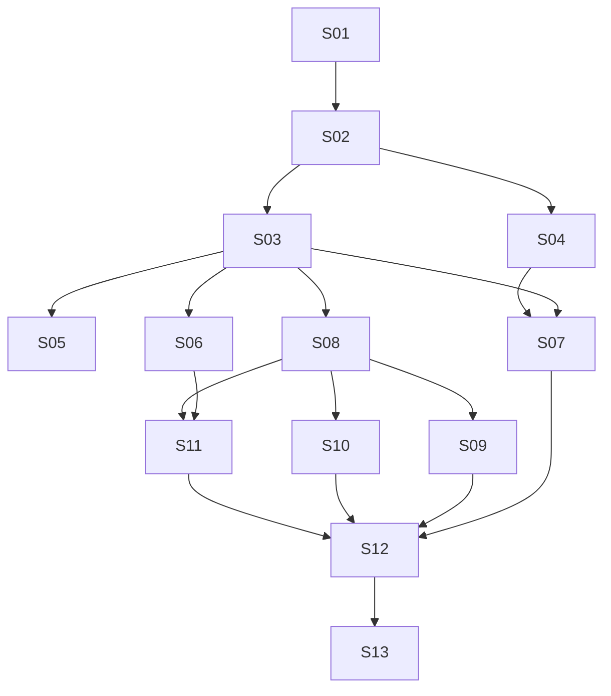

# Standalone Garden v1 — proposed Epic/Story index

**Date:** 2026-10-12 · **Status:** PROPOSED DECOMPOSITION — AWAITING WRITTEN-SPEC APPROVAL

Authoritative design: [specification for user review](../../specs/2026-10-12-garden-standalone-v1-design.md). Decision record: [ADR-0019](../../../architecture/0019-garden-standalone-v1.md). Research baseline: [Stage 1](../../../research/garden-standalone-v1.md), `76baea03e9913b8bfeb35c44cae0a66e4f5eed59`.

This is an outcome/dependency outline, **not executable Story plans, an approved backlog, or a complete implementation planning package**. Every Story is Proposed, none is Ready. No per-Story plan files are created before written-spec approval. Afterwards the architect must supply concrete changes/contracts, verification commands and expected results, refresh caller evidence, resolve applicable owner questions, and obtain implementation-plan review/execution selection. This index owns status/dependency data; the diagram and waves below are derived from the immediate-predecessor column.

## Scope reconciliation and independently accepted increments

[Issue #8](https://github.com/ProjectViVy/laputa/issues/8), created before this task and missed in the first overlap audit, owns the lean Mentle private/shared-memory slice. The specification §1.3 records the correction and conflicts. This index no longer makes BML qualification, the new Recap format or optional subsystem rewrites prerequisites for that slice. Existing `ProfileID` stays the subject identifier; sharing uses named resource membership with read/read_write access. No issue text authorizes execution.

- **M0 — lean private/shared slice:** S01–S03, including minimal reused UI/API for active profile, private/shared location, membership and removal. Use a working Mentle installation and existing scoped ACTMEM. It can be reviewed/accepted before S04–S13; no backend switch or automatic private publication.
- **M1 — broader standalone management:** S04, S06–S13 add the separately requested continuity, supported Mentle ownership handoff, explicit facts/autonomy cleanup, four hosts and full wizard/UI. The graph does not block this path on S05. Any interim release must say R3 alternate-backend delivery and BML-backed attachment are pending.
- **M2 — qualified alternate:** S05 delivers the real BML backend and verifies its applicable UI/client/attachment paths once those consumers exist. It is required for the broader backend goal, not M0. Q2 decides whether M1 and M2 must share a release date. No full-scope completion claim is possible while either remains incomplete.

These are proposed acceptance boundaries, not approved release dates or reduced product scope. Full UI, opted-in host features, safe secrets and canonical VIVY identity remain required by the main task.

## Proposed Epics

| Epic | Coherent outcome | Stories | Design decisions |
| --- | --- | --- | --- |
| E1 — Canonical subjects and governed access | Trusted local owner, existing profiles, named shared spaces and all enabled memory paths governed | S01–S03 | D1–D4, D11 |
| E2 — Continuity, backend choice and existing identity | Subject Recap, independently qualified BML alternate and safe existing-identity ownership | S04–S06 | D1, D4, D5, D7 |
| E3 — Explicit experience and host integrations | Selected facts without autonomy, consented host bindings and four-host product support | S07–S10 | D3, D6–D10, D12 |
| E4 — First launch and full management console | Restartable DeepSeek setup/upgrade plus actual state editing and permission/status UX | S11–S12 | D1, D2, D4, D5, D10 |
| E5 — Integrated release evidence and clean break | All proposed acceptance boundaries validated, old executable paths removed and documented | S13 | D1–D12 |

## Proposed Story boundaries and immediate dependencies

All rows have status **Proposed / not Ready**. Acceptance descriptions express future outcomes, not reported passes. Requirement IDs and decision IDs refer to the authoritative specification.

| Story | Independently verifiable outcome and boundary | Immediate predecessors and supplied contracts | Requirements | Acceptance evidence sought |
| --- | --- | --- | --- | --- |
| S01 | Reuse ProfileID registry and local single-owner composition; share existing memory resources; no data conversion or distributed ownership layer | — | R1, R10, R12 | Distinct profile handles share one service; path/ID conflict refused; supported concurrent writer refused; restart preserves binding. |
| S02 | Trusted host credential/profile binding and named shared-space membership read/read_write; bounded workers via existing handles | S01: profile registry and local owner boundary | R1, R2, R4, R6 | A/B/C private/shared rights and membership removal; body IDs/role token cannot widen access; no arbitrary private grants or capability delegation. |
| S03 | Complete Mentle private/shared vertical slice across enabled explicit and automatic memory paths, capture/retry and minimal reused UI; no optional subsystem rewrite | S02: trusted binding and membership resolution | R2, R3, R5, R11, R12 | Issue #8 focused A/B/S/C scenarios; participants/read-write controls; stale evidence/context denial, useful Chinese queries, CAS/receipts; optional unsafe multi-persona surfaces explicitly unavailable. R3 covers the Mentle baseline only. |
| S04 | Broader subject Recap/CAS/clear/deferred-tools work, with Q3-reviewed personal-only contribution policy or approved alternative; no mandatory source-union system | S02: bound profile/session access | R2, R4, R5, R8, R11 | Same-subject revision stream, restricted-session and worker denial, concurrent edit/clear/restart, commit-before-unload; coordinate #58 Work consumers without blocking M0. |
| S05 | Independent BML qualification over its existing module: explicit ProfileID mapping, canonical receipts and necessary management reads; no new BML implementation | S03: backend/binding conformance baseline | R2, R3, R10, R11 | Actual multi-profile one-DB adapter and explicit legacy mapping; conformance before selection. Validate supported consumer/attachment integration when available; broader R3 remains pending until this lane completes. |
| S06 | Supported existing Mentle-backed VIVY/Garden client attachment and explicit local owner handoff; preserve actual identity/data and current Recap format | S03: bound memory service and Mentle contract | R1, R3, R10, R11 | Same authoritative persona/revisions, stopped prior writer, minimal local lock/config, safe interrupted handoff. BML-backed attachment is unavailable until qualified in S05; no silent conversion or dual owner. |
| S07 | Selected evidence-to-fact and standalone autonomy removal; explicit selected shared writes only, no automatic publication or taint/declassification machinery | S03: governed mutations/lineage; S04: coordinated Recap/Work replacement | R8, R11, R12 | Private capture stays private; human-selected shared fact and operation-scoped source provenance work; shared DIVA receipts/Mission contracts survive justified cleanup. |
| S08 | Common consented host binding/projection, conflict/backup, independent controls and saved/written/loaded status | S03: authenticated host-facing memory operations | R2, R6, R7, R10 | Inert discovery/install, separate controls, compare-before-write, revoke and queued-write recheck; no false loaded state. |
| S09 | OpenClaw and Hermes native adapters using S08; selected capture/recall and persona sync with version-qualified limits | S08: common binding/projection/status contract | R6, R7, R8 | Both native adapters pass cold/new-session, recall, selected capture, disable/revoke and preservation cases; Hermes cached session distinguished. |
| S10 | Claude Code and Codex CLI instruction-file + explicit MCP adapters; optional hook experiments separately labeled | S08: common binding/projection/status contract | R6, R7, R8 | Both CLIs preserve instructions and hierarchy, use scoped MCP, support explicit selected capture and revocation; hook experiments do not count as committed lifecycle acceptance. |
| S11 | DeepSeek-only persisted setup, private host secrets, create/attach/skip, optional hosts and safe upgrades; smallest writable model-less Mentle delta | S06: supported takeover and provider status; S08: inert optional host setup | R3, R9, R10 | Resume/complete without repeated wizard, private credentials, key failure and backup recovery; BML choice/attachment honestly unavailable until qualification. |
| S12 | Full human console/headless parity: real Persona/Recap/memory/history/lineage, shared-space membership, hosts and health; reuse existing pages | S07: fact/Recap and cleanup contracts; S09: native host status; S10: CLI host status; S11: setup/upgrade | R1, R2, R4, R5, R6, R8, R9 | Actual revisions/conflicts, read/read_write participants, source visibility, provider status and saved/written/loaded. Required UI remains complete even when optional agent graph/trace is unavailable. |
| S13 | Integrated acceptance of delivered M1 surfaces and removal audit, with precise residual backend status; not an optional hardening project | S12: integrated management/host/setup surfaces | R1–R12 (R3 alternate acceptance remains with S05) | Focused spec §10 cases, supported local ownership and four hosts; reuse BML-first VIVY and owner Mentle-through-DIVA evidence. No full backend-choice claim without M2; preserve useful single-persona features. |

S03 removes memory bypasses when replacing them; S07 removes autonomy paths when disentangling them; S13 verifies removal rather than postponing deletion indefinitely. Each Story includes its necessary focused documentation/tests/packaging. No separate ceremonial “setup”, “write tests” or “update status” Stories are created.

## Dependency graph and waves

| Topological wave | Proposed Stories | Meaning |
| --- | --- | --- |
| 0 | S01 | Ownership/registry foundation |
| 1 | S02 | Trusted identity and policy |
| 2 | S03, S04 | Memory boundary and Recap contracts |
| 3 | S05, S06, S07, S08 | Independent backend lane, Mentle attachment, facts/cleanup, host core |
| 4 | S09, S10, S11 | Concrete hosts and setup/upgrade |
| 5 | S12 | Full management integration |
| 6 | S13 | Scoped integration acceptance and clean-break audit |

These are logical orderings, not authorization for parallel agents or an estimate. S05 is a separate branch of the DAG: its appearance in a wave does not make completion a barrier for the M1 path. Its final backend qualification must include consumer integration where offered; an adapter-only test pass is insufficient. UI layout exploration can occur earlier after design approval, but S12's end-to-end evidence consumes implemented predecessor contracts. File conflicts are separate: S03/S04/S07 touch `garden/agentapi` and server contracts; S01/S03/S06/S11 share composition/config; S08–S12 share console shell/API/types; S04/S06/S07 cross VIVY cognitive DTOs and shared DIVA effects. Sequence these edits or use isolated worktrees and agreed interface revisions after execution is authorized. Do not assume a DAG wave eliminates merge conflicts.

## External dependencies and owner gates

| Gate | Owner/evidence | Affected Stories and exact needed outcome |
| --- | --- | --- |
| X1 | Laputa #1/#7/#8; spec §5 | S03 uses a working Mentle composition and checks representative retrieval. S11 needs the smallest writable no-embedding setup delta. Do not gate sharing on the full enhancement backlog or a speculative index rewrite. |
| X2 | VIVY #57/#58 and accepted ADR-0018 | S04/S07: existing session/worker access, Q3-reviewed Recap admission/coverage and LIFE-first/CODE-negative tests in the existing unified pipeline; shared Work/DTO callers reconciled before removal. |
| X3 | VIVY BML maintainers, existing `bml` module | S05: explicit ProfileID mapping, one-DB multi-profile storage, receipts and required reads. BML-backed attachment waits on qualification; Mentle attachment in S06 and M0 do not. |
| X4 | Exact host releases and installed test environments | S09/S10: pin versions/API surfaces and prove committed matrix; experimental hooks may remain experimental. Unavailable host evidence remains blocked, never a pass. |
| X5 | Owner review Q1–Q5 in spec | All: written-spec approval first; Q1 confirms attachment packaging, Q2 backend release timing, Q3 restricted-session Recap behavior, Q4 host commitment, Q5 initial OS/secret acceptance. Resolve before affected Story plans can become Ready. |

## Requirement coverage

| Requirement | Primary coverage | Integration acceptance |
| --- | --- | --- |
| R1 | S01, S02, S06, S12 | S13 |
| R2 | S02, S03, S04, S05, S08, S12 | S13 |
| R3 | S03, S05, S06, S11 | S05 alternate qualification; S13 reports delivered baseline and any residual gap |
| R4 | S02, S04, S12 | S13 |
| R5 | S03, S04, S12 | S13 |
| R6 | S02, S08, S09, S10, S12 | S13 |
| R7 | S08, S09, S10 | S13 |
| R8 | S04, S07, S09, S10, S12 | S13 |
| R9 | S11, S12 | S13 |
| R10 | S01, S05, S06, S08, S11 | S13 |
| R11 | S03, S04, S05, S06, S07 | S13 |
| R12 | S01, S03, S07 | S13 |

## Evidence and current state

Stage 1 and the initial architecture commit `9b25ef4` remain unchanged in history. This bounded correction incorporates pre-existing issue #8 and revises the proposed dependency/acceptance boundaries. Stage 2 source checks and design rationale are in the specification; implementation evidence is absent by design. Documentation validation checks relative targets/anchors, existing source paths, requirement IDs, dependency references, no self-edges/cycles/redundant transitive edges, graph/table/wave agreement and `git diff --check`. Application suites are intentionally not run for documentation-only work. Remote branch/commit verification belongs to the delivery response; no mutable branch link is treated as a runtime acceptance artifact.

The next action is owner review of the written specification. No Story execution is available from this index.
